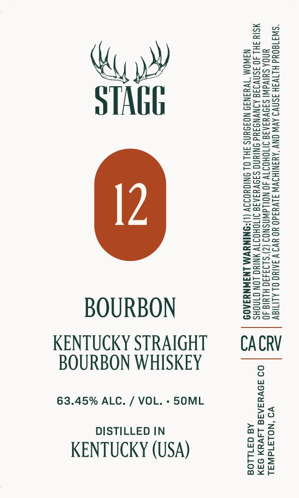

# TTB COLA Label Images - TTBID 26296001000489

**Brand Name:** STAGG

**Issue Date:** 10/28/2026

**Origin Code:** 01

**Product Class/Type:** 101

**Source:** [TTB Public COLA Registry](https://ttbonline.gov/colasonline/viewColaDetails.do?action=publicFormDisplay&ttbid=26296001000489)

## Label Images

### Label 1

## Extracted Label Text

*Text extracted via OCR - may contain errors*

**Detected Proof:** 126.9

### Label 1

ZzEaeo

=sSa

eT

Save

Beet

wi

My

saw

==

eos

eu

nD

STAGE

S2So=

BOOS

Zac

BSaz

Sae>

Sow

Siaa

enS>

wos

==eoz

ASC=

S=

-Sze

Sa

ea=as

oos=

FSc2

ee

Ss=2s5=

2eug

SSset

Suzy

sos

SS

=a oe

Sorts

ooo

Sa55

SSce

Zsso

S2a

s=R=

e205

pues

S2eu

Geos

Sous

E=eo=

=Sco

ee

a

Boze

BOURBON

Ons

Sf2ua

Ssal

KENTUCKY STRAIGHT

CACRV

BOURBON WHISKEY

63.45% ALC. / VOL. - 50ML

no

Sa

DISTILLED IN

aro

<u

KENTUCKY (USA)

e¥a

ge w

ou

os

axe
