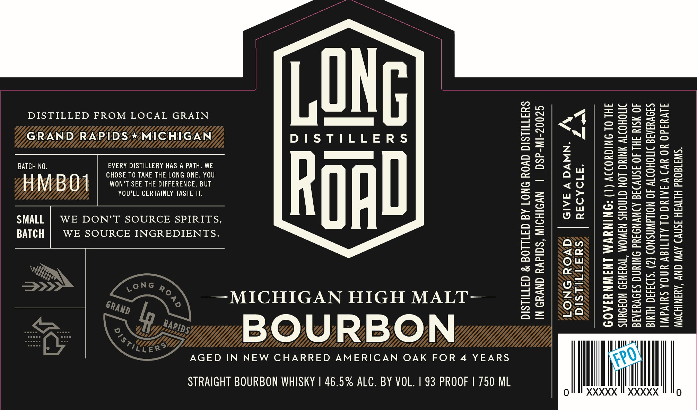

# TTB COLA Label Images - TTBID 26296001000503

**Brand Name:** LONG ROAD DISTILLERS

**Fanciful Name:** MICHIGAN HIGH MALT BOURBON

**Issue Date:** 10/29/2026

**Origin Code:** 06

**Product Class/Type:** 101

**Source:** [TTB Public COLA Registry](https://ttbonline.gov/colasonline/viewColaDetails.do?action=publicFormDisplay&ttbid=26296001000503)

## Label Images

### Label 1

## Extracted Label Text

*Text extracted via OCR - may contain errors*

**Detected Proof:** 93
**Detected Age:** 4 Years

### Label 1

DISTILLED FROM LOCAL GRAIN Pare ea
— =e 4

GRAND/RAPIDS/*/MICHIGAN DISTILLERS os ~l

ss as| =

BATCH NO. EVERY DISTILLERY HAS A PATH. WE S a <q A
CHOSE TO TAKE THE LONG ONE. YOU [a4 (2) al

Wl M B O WON'T SEE THE DIFFERENCE, BUT oo” {tO
YOU'LL CERTAINLY TASTE IT. Ss = Ww Pal

33/>9

So | er

SMALL | WE DON’T SOURCE SPIRITS, a5 | Oe
BATCH | WE SOURCE INGREDIENTS. ie | eee
Fw | aw

52) 32

8 oS

Be| o=

= E

—MICHIGAN HIGH MALT— 22 Ze
BOURBON”
AGED IN NEW CHARRED AMERICAN OAK FOR 4 YEARS |

STRAIGHT BOURBON WHISKY | 46.5% ALC. BY VOL. | 93 PROOF | 750 ML
0

XXXXX

(1) ACCORDING TO THE

IMPAIRS YOUR ABILITY TO DRIVE A CAR OR OPERATE

SURGEON GENERAL, WOMEN SHOULD NOT DRINK ALCOHOLIC
BEVERAGES DURING PREGNANCY BECAUSE OF THE RISK OF
BIRTH DEFECTS. (2) CONSUMPTION OF ALCOHOLIC BEVERAGES
MACHINERY, AND MAY CAUSE HEALTH PROBLEMS.

GOVERNMENT WARNING

XXXXX
