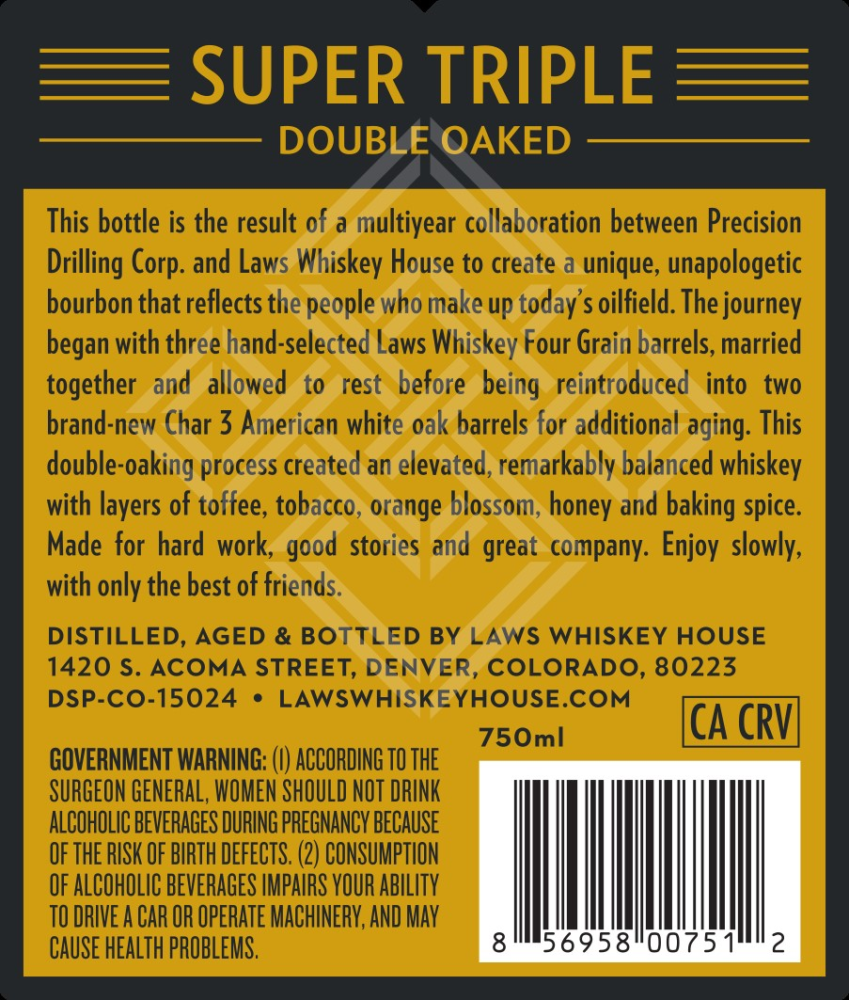
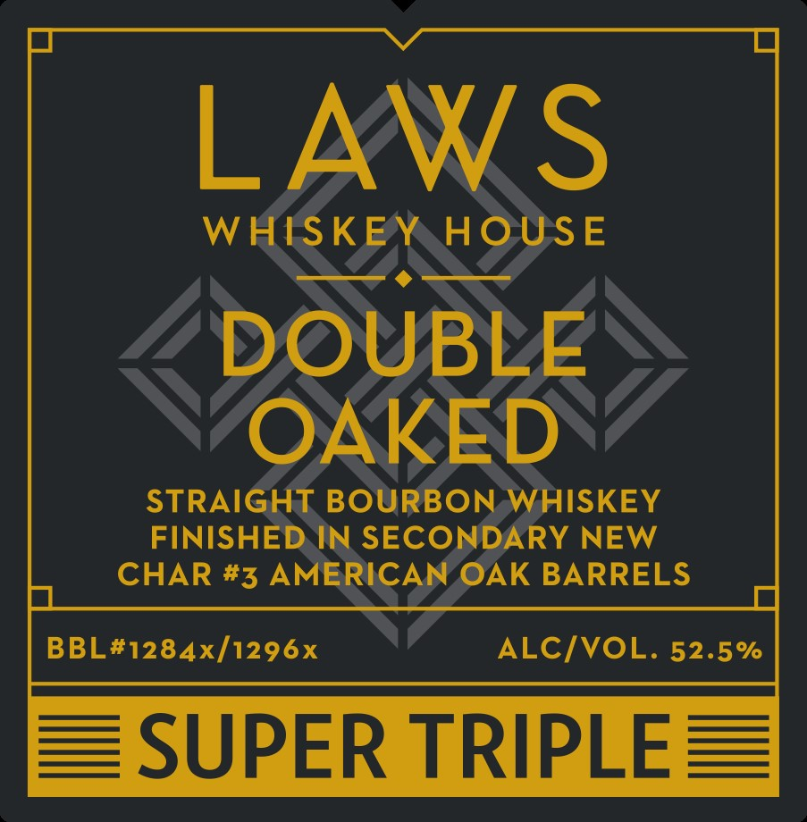
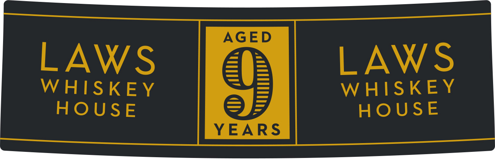

# TTB COLA Label Images - TTBID 26296001000549

**Brand Name:** LAWS WHISKEY HOUSE

**Fanciful Name:** SUPER TRIPLE

**Issue Date:** 10/28/2026

**Origin Code:** 13

**Product Class/Type:** 101

**Source:** [TTB Public COLA Registry](https://ttbonline.gov/colasonline/viewColaDetails.do?action=publicFormDisplay&ttbid=26296001000549)

## Label Images

### Back Label

### Front Label

### Label 3

## Extracted Label Text

*Text extracted via OCR - may contain errors*

### Back Label

SUPER TRIPLE
DOUBLE OAKED
This bottle is the result of a multiyear collaboration between Precision
Drilling
and Laws Whiskey House to create a unique, unapologetic
bourbon that reflects the people who make up today's oilfield. The journey
began with three hand-selected Laws Whiskey Four Grain barrels, married
together  and  allowed
to
rest  before   being  reintroduced  into   two
brand-new Char 3 American white oak barrels for additional aging: This
double-oaking process created an elevated, remarkably balanced whiskey
with layers of toffee; tobacco, orange blossom, honey and baking spice:
Made for hard work;
stories and great  company: Enjoy slowly,
with only the best of friends.
DISTILLED, AGED & BOTTLED BY LAWS WHISKEY HOUSE
1420 $. ACOMA STREET, DENVER, COLORADO, 80223
DSP-C0-15024
LAWSWHISKEYHOUSE.COM
750ml
CA CRVI
GOVERNMENT WARNING:
ACCORDING TO THE
SURGEON GENERAL, WOMEN SHOULD NOT DRINK
ALCOHOLIC BEVERAGES DURING PREGNANCY BECAUSE
OF THE RISK OF BIRTH DEFECTS: (2) CONSUMPTION
OF ALCOHOLIC BEVERAGES IMPAIRS VOUR AblLITy
TO DRIVE A CAR OR OPERATE MACHINERV; AND May
CAuSe healTh PROBLEMS.
8
56958"00751
2
Corp:
good

### Front Label

LAWS
WHISKEY
HOUSE
DOUBLE
OAKED
STRAIGHT BOURBON WHISKEY
FINISHED IN SECONDARY NEW
CHAR #3 AMERICAN OAK BARRELS
BBL#1284x/1296x
ALCIVOL. 52.5%
SUPER TRIPLE

### Label 3

AGED

LAWS

LAWS

WHISKEY

WHISKEY

HOUSE

YEARS

HOUSE
