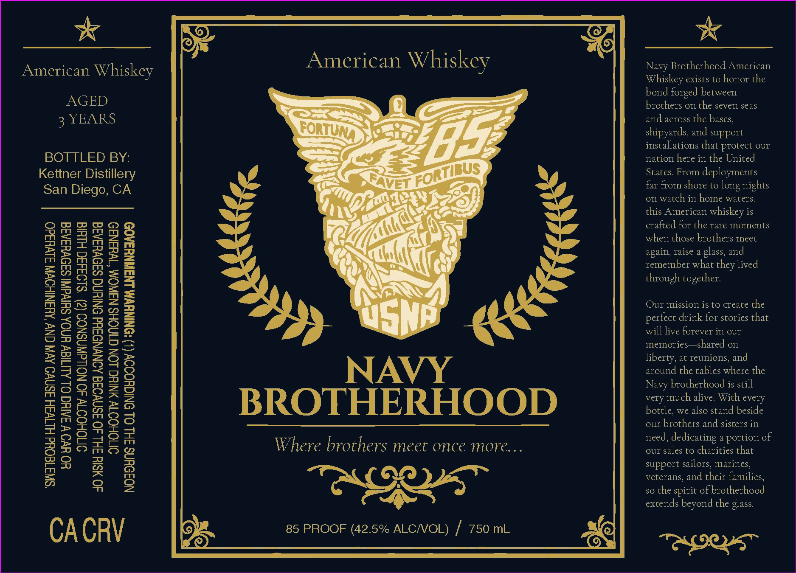

# TTB COLA Label Images - TTBID 26296001000632

**Brand Name:** NAVY BROTHERHOOD

**Issue Date:** 11/24/2026

**Origin Code:** 01

**Product Class/Type:** 140

**Source:** [TTB Public COLA Registry](https://ttbonline.gov/colasonline/viewColaDetails.do?action=publicFormDisplay&ttbid=26296001000632)

## Label Images

### Label 1

## Extracted Label Text

*Text extracted via OCR - may contain errors*

**Detected Proof:** 85
**Detected Age:** 3 Years

### Label 1

American Whiskey

AGED
3 YEARS

BOTTLED BY:
Kettner Distillery
San Diego, CA

ONINUVM LNSWNYSA0S

OMOHOIT JO NOLAWNSNOO (2) ‘SL03430 HLYla

4O SIU SHL 40 SSNV9I8 AONYNDSud ONIUN SADVYSASE
OMOHOOT NIC LON CINOHS NAWOM “THINS

YO YVO V SAIHC OL ALITIAY YNOA SHIVdWI SSDVHIAIE
NOJOYNS SHI OL NNIGHODOV (1)

SWSTEOd HITVSH SSNVO AV CNY ‘ABSNIHOWW SWHad0

NAVY
BROTHERHOOD

Where brothers meet once more...

85 PROOF (42.5% ALC/VOL) / 750 mL

Navy Brotherhood American
Whiskey exists to honor the
bond forged between
brothers on the seven seas
and across the bases,
shipyards, and support
installations that protect our
nation here in the United
States. From deployments
far from shore to long nights
on watch in home waters,
this American whiskey is
crafted for the rare moments
when those brothers meet
again, raise 2 glass, and
remember what they live
through together.

Our mission is to create the
perfect drink for stories that
will live forever in our
memories—shared on
liberty, at reunions, and
around the tables where the
Navy brotherhood is still
very much alive. With every
bottle, we also stand beside
our brothers and sisters in
need, dedicating a portion of
our sales to charities that
support sailors, marines,
veterans, and their families,
so the spirit of brotherhood
extends beyond the glass.
