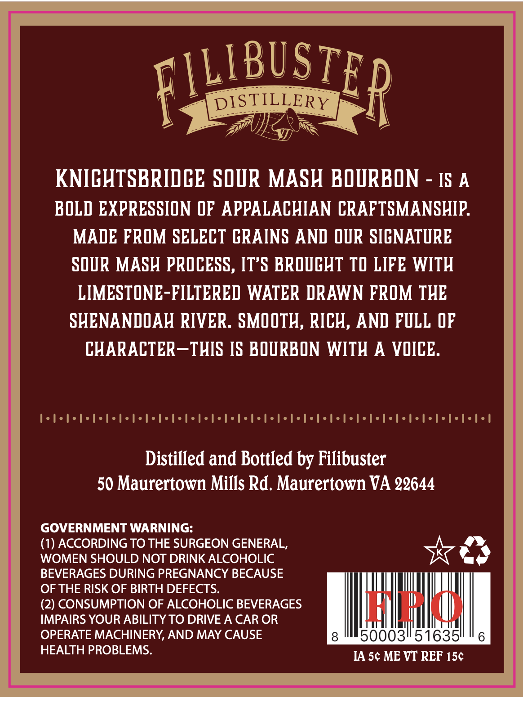
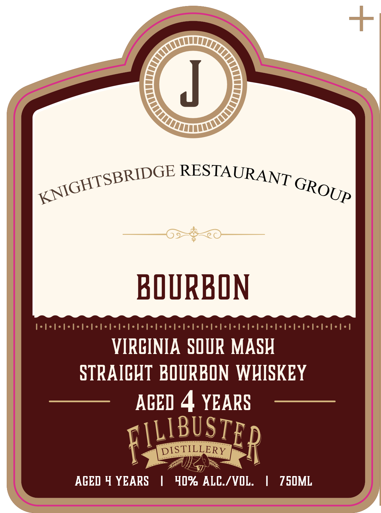

# TTB COLA Label Images - TTBID 26298001000022

**Brand Name:** KNIGHTSBRIDGE RESTAURANT GROUP

**Issue Date:** 10/28/2026

**Origin Code:** 05

**Product Class/Type:** 101

**Source:** [TTB Public COLA Registry](https://ttbonline.gov/colasonline/viewColaDetails.do?action=publicFormDisplay&ttbid=26298001000022)

## Label Images

### Back Label

### Label 1

## Extracted Label Text

*Text extracted via OCR - may contain errors*

**Detected Proof:** 80
**Detected Age:** 4 Years

### Back Label

FILBUSTER
DISTILLERY
KNICHTSBRIDCE SOUR MASH BOURBON
IS A
BOLD EXPRESSILON QF APPALACHIAN CRAFTSMANSHIP
MADE FROM SELECT CRAINS AND OUR SICNATURE
SOUR MASH PROCESS, IT'S BROUCHT TO LIFE WITH
LIMESTONE-FILTERED WATER DRAWN FROM THE
SHENANDOAH RIVER. SMOOTH, RICH, AND FULL @F
CHARACTER_THIS IS BOURBON WITH A VOICE.
Distilled and Bottled by Filibuster
50 Maurertown Mills Rd. Maurertown VA 22644
GOVERNMENT WARNING:
(1) ACCORDING TO THE SURGEON GENERAL,
WOMEN SHOULD NOT DRINK ALCOHOLIC
BEVERAGES DURING PREGNANCY BECAUSE
OF THE RISK OF BIRTH DEFECTS:
(2) CONSUMPTION OF ALCOHOLIC BEVERAGES
KHLLAHHHX
IMPAIRS YOUR ABILITY TO DRIVE A CAR OR
OPERATE MACHINERY, AND MAY CAUSE
500031/516351
6
HEALTH PROBLEMS.
IA 5c ME VT REF 15c

### Label 1

—

J

yGHTSP

RIDGE RESTAURANT GRo

BOURBON

Volodedebotododededototodetetetododedetotodedetototodetetetotodelelel

VIRGINIA SOUR MASH

STRAIGHT BOURBON WHISKEY

——EEE

AGED 4 YEARS ——

1

STILLERY

BUS

AGED Y YEARS | 40% ALC./VOL. | 750ML
