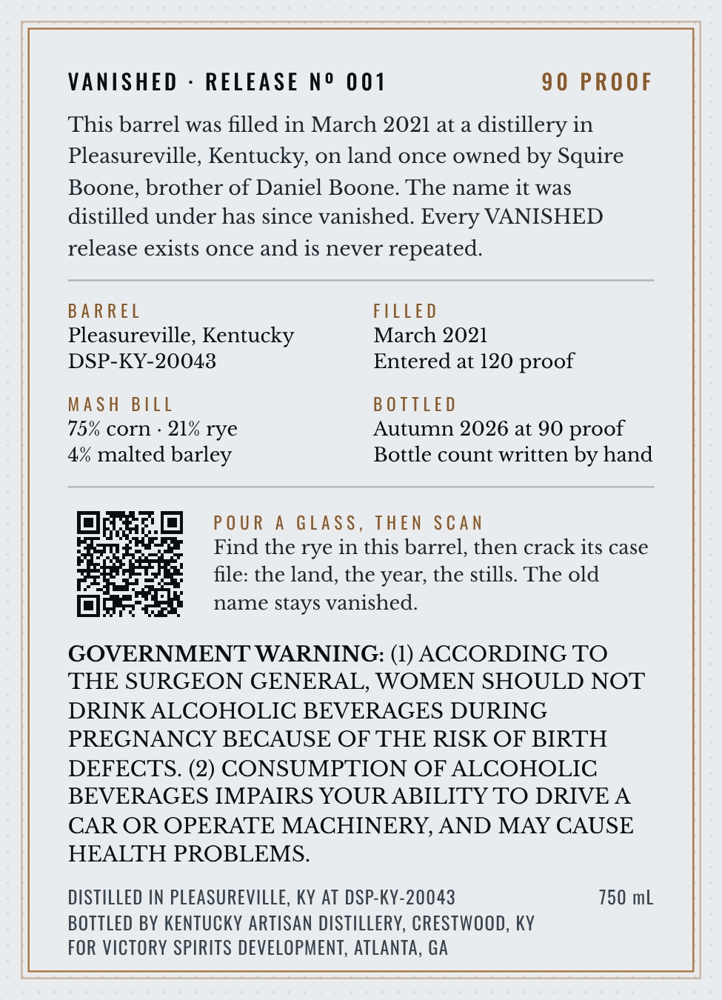
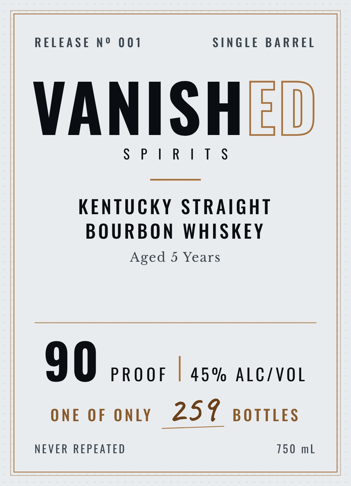

# TTB COLA Label Images - TTBID 26298001000023

**Brand Name:** VANISHED

**Issue Date:** 10/28/2026

**Origin Code:** 22

**Product Class/Type:** 101

**Source:** [TTB Public COLA Registry](https://ttbonline.gov/colasonline/viewColaDetails.do?action=publicFormDisplay&ttbid=26298001000023)

## Label Images

### Back Label

### Front Label

### Label 3

### Label 4

## Extracted Label Text

*Text extracted via OCR - may contain errors*

*1 image(s) excluded: text did not meet readability threshold*

**Detected Proof:** 90
**Detected Age:** 5 Years

### Back Label

VAniShED
RELEASE
No 001
90 PROOF
This barrel was filled in March 2021 at a
distillery in
Pleasureville, Kentucky, on land once owned by Squire
Boone; brother of Daniel Boone. The name it was
distilled under has since vanished Every VANISHED
release exists once and is never repeated
BA R REL
FILLED
Pleasureville, Kentucky
March 2021
DSP-KY-20043
Entered at 120 proof
Mash BILL
B 0 TTLED
75% corn
21% rye
Autumn 2026 at 90 proof
4% malted barley
Bottle count written by hand
P0 U R
GLass, THEN SCan
Find the rye in this barrel, then crack its case
file: the land, the year; the stills The old
name stays vanished:
GOVERNMENT WARNING: (1) ACCORDING TO
THE SURGEON GENERAL, WOMEN SHOULD NOT
DRINK ALCOHOLIC BEVERAGES DURING
PREGNANCY BECAUSE OF THE RISK OF BIRTH
DEFECTS. (2) CONSUMPTION OF ALCOHOLIC
BEVERAGES IMPAIRS YOUR ABILITY TO DRIVE A
CAR OR OPERATE MACHINERY, AND MAY CAUSE
HEALTH PROBLEMS.
DISTILLED AN PLEASUREVILLE, KY AT DSP-KY-20043
750 mL
BOTTLED BY KENTUCKY ARTISAN DISTILLERV, CRESTWOOD, KY
FOR VICTORY SPIRITS DEVELOPMENT, ATLANTA, GA

### Front Label

RELEASE N° 001 SINGLE BARREL
SPIRITS
KENTUCKY STRAIGHT
BOURBON WHISKEY
Aged 5 Years
90 PROOF | 45% ALC/VOL
ONE oF ontY 257 sorties
NEVER REPEATED 750 mL

### Label 3

VANISHED

DISTILLED IN 2021

UNDER A NAME

THAT HAS VANISHED

and

BOTTLED FROM

A SINGLE BARREL
