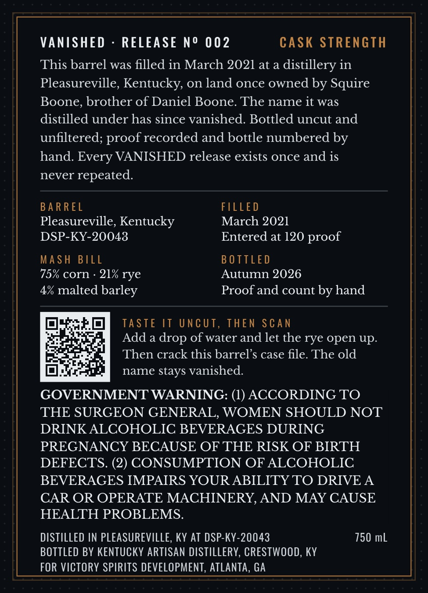
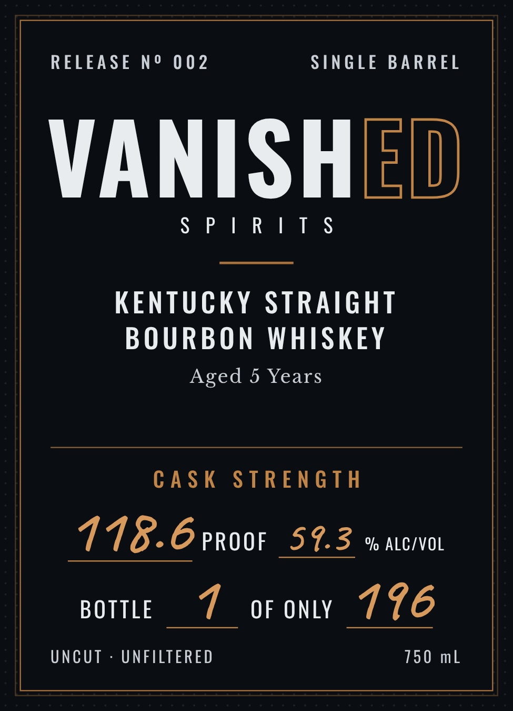
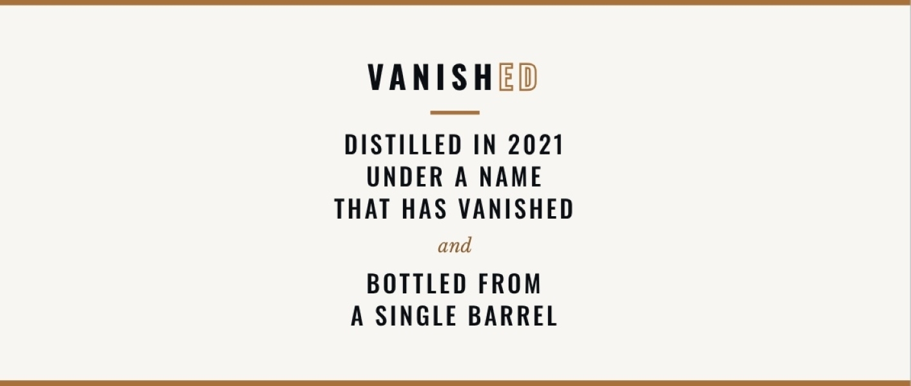
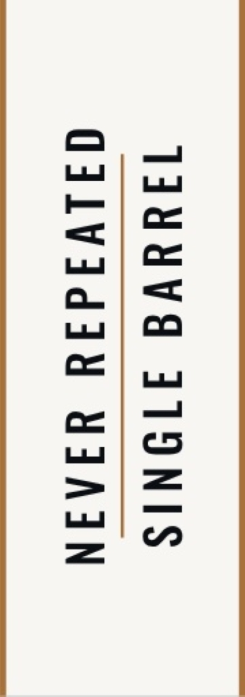

# TTB COLA Label Images - TTBID 26298001000025

**Brand Name:** VANISHED

**Issue Date:** 11/13/2026

**Origin Code:** 22

**Product Class/Type:** 101

**Source:** [TTB Public COLA Registry](https://ttbonline.gov/colasonline/viewColaDetails.do?action=publicFormDisplay&ttbid=26298001000025)

## Label Images

### Back Label

### Front Label

### Label 3

### Label 4

## Extracted Label Text

*Text extracted via OCR - may contain errors*

*1 image(s) excluded: text did not meet readability threshold*

**Detected Proof:** 120
**Detected Age:** 5 Years

### Back Label

VANISHED - RELEASE N° 002 CASK STRENGTH
This barrel was filled in March 2021 at a distillery in
Pleasureville, Kentucky, on land once owned by Squire
Boone, brother of Daniel Boone. The name it was
distilled under has since vanished. Bottled uncut and
unfiltered; proof recorded and bottle numbered by
hand. Every VANISHED release exists once and is
never repeated.
BARREL BUELED:
Pleasureville, Kentucky March 2021
DSP-KY-20043 Entered at 120 proof
MASH BILL BOTTLED
75% corn - 21% rye Autumn 2026
4% malted barley Proof and count by hand
lpaepac TASTE IT UNCUT, THEN SCAN
Bae Add a drop of water and let the rye open up.
Bet ak Then crack this barrel’s case file. The old
ORB name stays vanished.
GOVERNMENT WARNING: (1) ACCORDING TO
THE SURGEON GENERAL, WOMEN SHOULD NOT
DRINK ALCOHOLIC BEVERAGES DURING
PREGNANCY BECAUSE OF THE RISK OF BIRTH
DEFECTS. (2) CONSUMPTION OF ALCOHOLIC
BEVERAGES IMPAIRS YOUR ABILITY TO DRIVE A
CAR OR OPERATE MACHINERY, AND MAY CAUSE
HEALTH PROBLEMS.
DISTILLED IN PLEASUREVILLE, KY AT DSP-KY-20043 750 mL
BOTTLED BY KENTUCKY ARTISAN DISTILLERY, CRESTWOOD, KY
FOR VICTORY SPIRITS DEVELOPMENT, ATLANTA, GA

### Front Label

RELEASE N° 002 SINGLE BARREL
SPIRITS
KENTUCKY STRAIGHT
BOURBON WHISKEY
Aged 5 Years
CASK STRENGTH
1178.6 proot 59.3 % atcivor
pote 497 orony 776
UNCUT - UNFILTERED 750 mL

### Label 3

VANISHED

DISTILLED IN 2021

UNDER A NAME

THAT HAS VANISHED

and

BOTTLED FROM

A SINGLE BARREL
