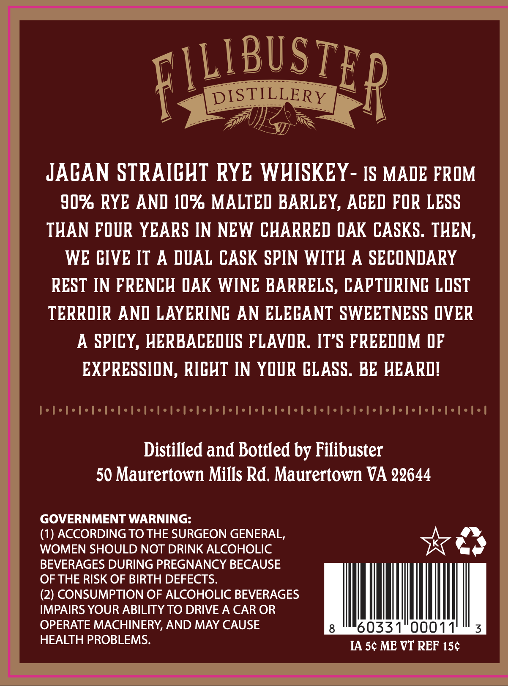
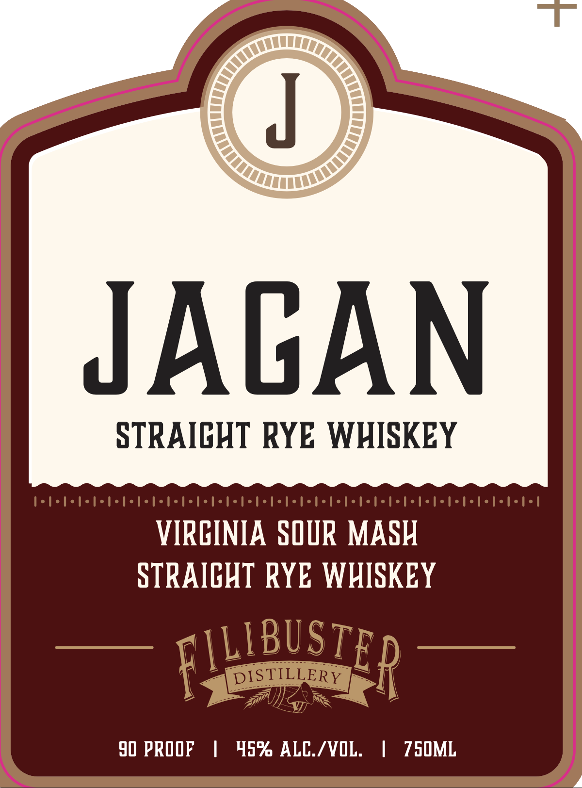

# TTB COLA Label Images - TTBID 26298001000027

**Brand Name:** JAGAN

**Issue Date:** 10/30/2026

**Origin Code:** 05

**Product Class/Type:** 102

**Source:** [TTB Public COLA Registry](https://ttbonline.gov/colasonline/viewColaDetails.do?action=publicFormDisplay&ttbid=26298001000027)

## Label Images

### Back Label

### Label 1

## Extracted Label Text

*Text extracted via OCR - may contain errors*

**Detected Proof:** 90

### Back Label

FWLBUSTER
DISTILLERY
JACAN STRAICHT RYE WHISKEY
IS MADE FROM
90% RYE AND 10% MALTED BARLEY, ACED FOR LESS
THAN FOUR YEARS IN NEW CHARRED QAK CASKS. THEN,
WE CIVE IT
A DUAL CASK SPIN WITH
A SECONDARY
REST IN FRENCH QAK WINE BARRELS, CAPTURING LOST
TERROIR AND LAYERINC AN ELECANT SWEETNESS OVER
A SPICY, HERBACEOUS FLAVOR. IT S FREEDOM DF
EXPRESSION, RICHT IN YOUR CLASS. BE HEARDI
Distilled and Bottled by Filibuster
50 Maurertown Mills Rd. Maurertown VA 22644
GOVERNMENT WARNING:
(1) ACCORDING TO THE SURGEON GENERAL,
WOMEN SHOULD NOT DRINK ALCOHOLIC
BEVERAGES DURING PREGNANCY BECAUSE
OF THE RISK OF BIRTH DEFECTS.
(2) CONSUMPTION OF ALCOHOLIC BEVERAGES
IMPAIRS YOUR ABILITY TO DRIVE A CAR OR
OPERATE MACHINERY, AND MAY CAUSE
6033
0001
3
HEALTH PROBLEMS:
IA 5c ME VT REF 15c

### Label 1

T
JACAN
STRAICHT RYE WHISKEY
VIRCINIA SOUR MASH
STRAICHT RYE WHISKEY
FIUBUSTER
DISTILLERY
90 PROOF
45% ALC_/VOL:
750ML
