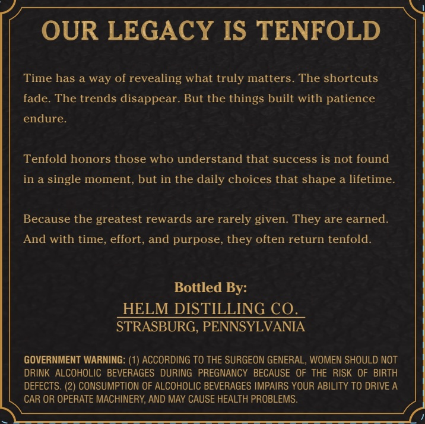
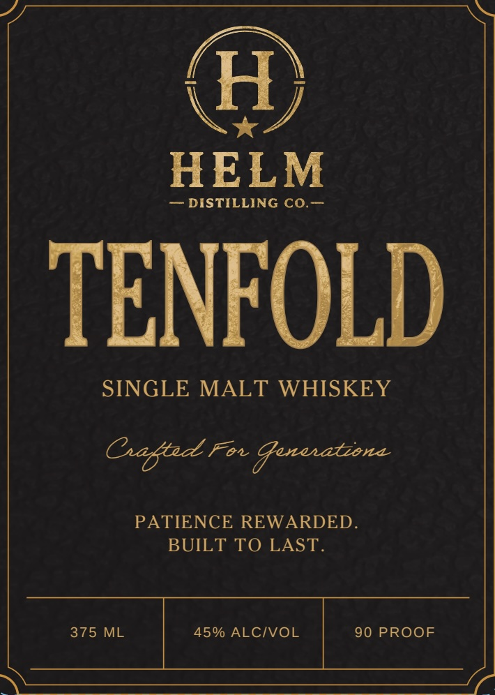

# TTB COLA Label Images - TTBID 26299001000106

**Brand Name:** HELM DISTILLING CO.

**Fanciful Name:** TENFOLD

**Issue Date:** 10/29/2026

**Origin Code:** 39

**Product Class/Type:** 118

**Source:** [TTB Public COLA Registry](https://ttbonline.gov/colasonline/viewColaDetails.do?action=publicFormDisplay&ttbid=26299001000106)

## Label Images

### Back Label

### Front Label

## Extracted Label Text

*Text extracted via OCR - may contain errors*

**Detected Proof:** 90

### Back Label

OUR LEGACY IS TENFOLD
Time has a way of revealing what truly matters. The shortcuts
fade: The trends disappear. But the things built with patience
endure.
Tenfold honors those who understand that success is not found
in a single moment, but in the daily choices that shape a lifetime.
Because the greatest rewards are rarely given: They are earned
And with time, effort, and purpose, they often return tenfold.
Bottled By:
HELM DISTILLING CQ.
STRASBURG, PENNSYLVANIA
GOVERNMENT WARNING: (1) ACCORDING TO THE SURGEON GENERAL, WOMEN SHOULD NOT
DRINK  ALCOHOLIC BEVERAGES DURING  PREGNANCY BECAUSE OF THE RISK OF BIRTH
DEFECTS:
(2) CONSUMPTION OF ALCOHOLIC BEVERAGES IMPAIRS YOUR ABILITY TO DRIVE A
CAR OR OPERATE MACHINERY, AND MAY CAUSE HEALTH PROBLEMS:

### Front Label

H)
HELM
DISTILLING CO.
TENFOLD
SINGLE MALT WHISKEY
Gafted Fox Gnenatzena
PATIENCE REWARDED_
BUILT TO LAST.
375 ML
450 ALCIVOL
90 PROOF
