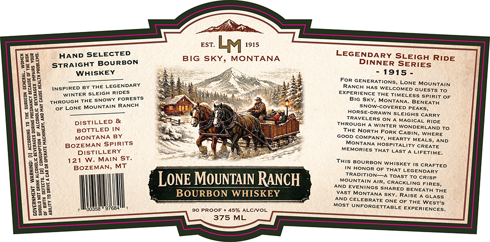

# TTB COLA Label Images - TTBID 26299001000195

**Brand Name:** LONE MOUNTAIN RANCH BOURBON WHISKEY

**Issue Date:** 10/30/2026

**Origin Code:** 30

**Product Class/Type:** 101

**Source:** [TTB Public COLA Registry](https://ttbonline.gov/colasonline/viewColaDetails.do?action=publicFormDisplay&ttbid=26299001000195)

## Label Images

### Label 1

## Extracted Label Text

*Text extracted via OCR - may contain errors*

### Label 1

HAND SELECTED
STRAIGHT BOURBON
WHISKEY
EIR RESIS

= LEGENDARY
spine oY THE LEGEND
my WINTER arsine pee
sxowy
qHroucn THE one
seo tSne MOUNTAIN RANCH
SOON TS
DISTILLED &
BOTTLED IN
MONTANA BY
BOZEMAN SPIRITS
DISTILLERY
121 W. MAIN ST.
BOZEMAN, MT

esr Ly 1915

BIG SKY, MONTANA

LONE MOUNTAIN RANCH

BOURBON WHISKEY

375 ML

LEGENDARY SLEIGH RIDE
DINNER SERIES

-1915-

FOR GENERATIONS, LONE MOUNTAIN.
RANCH HAS WELCOMED GUESTS To
EXPERIENCE THE TIMELESS sriRiT OF.
BIG Sky, MONTANA. BENEATH
SNOW-COVERED PEAKS,
HORSE-DRAWN SLEIGHS CARRY
TRAVELERS ON A MAGICAL RIDE
THROUGH A WINTER WONDERLAND TO
THE NORTH FORK CABIN, WHERE
GOOD COMPANY, HEARTY MEALS, AND
MONTANA HOSPITALITY CREATE
MEMORIES THAT LAST A LIFETIME,

THIS BOURBON WHISKEY Is CRAFTED.
IN HONOR OF THAT LEGENDARY.
TRADITION—A TOAST To Crisp.

MOUNTAIN AIR, CRACKLING FIRES,
AND EVENINGS SHARED BENEATH THE
VAST MONTANA SKY. RAISE A GLASS
AND CELEBRATE ONE OF THE Weor's
MOST UNFORGETTABLE EXPERIENCES,
