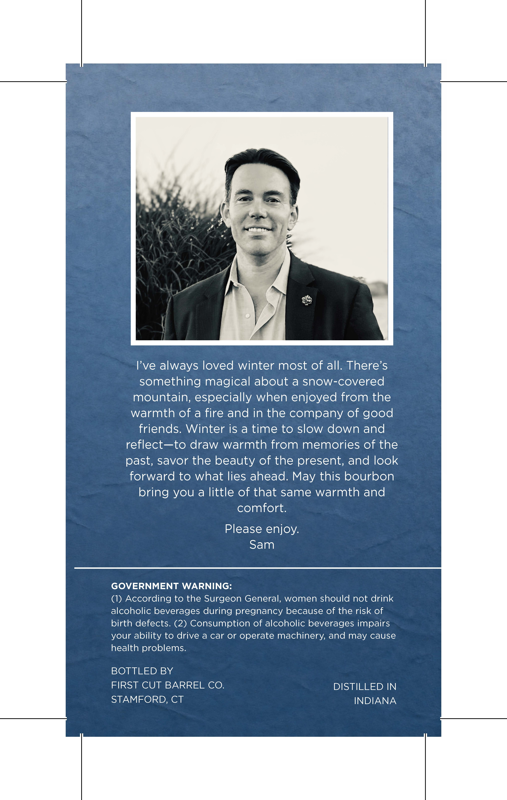
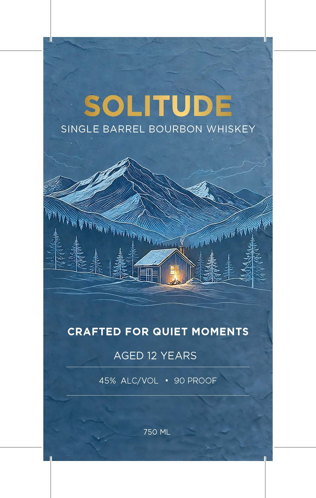

# TTB COLA Label Images - TTBID 26299001000248

**Brand Name:** SOLITUDE

**Issue Date:** 10/29/2026

**Origin Code:** 14

**Product Class/Type:** 141

**Source:** [TTB Public COLA Registry](https://ttbonline.gov/colasonline/viewColaDetails.do?action=publicFormDisplay&ttbid=26299001000248)

## Label Images

### Back Label

### Front Label

## Extracted Label Text

*Text extracted via OCR - may contain errors*

**Detected Proof:** 90
**Detected Age:** 12 Years

### Back Label

Ive always loved winter most of all. There's
something magical about a snow-covered
mountain; especially when enjoyed from the
warmth of a fire and in the company of good
friends. Winter is a time to slow down and
reflect-_to draw warmth from memories of the
past; savor the beauty of the present; and look
forward to what lies ahead: May this bourbon
bring you a little of that same warmth and
comfort:
Please enjoy:
Sam
GOVERNMENT WARNING:
(1) According to the Surgeon General, women should not drink
alcoholic beverages during pregnancy because of the risk of
birth defects. (2) Consumption of alcoholic beverages impairs
your ability to drive a car or operate machinery; and may cause
health problems:
BOTTLED BY
FIRST CUT BARREL CO.
DISTILLED IN
STAMFORD, CT
INDIANA

### Front Label

SOLITUDE
SINGLE BARREL BOURBON WHISKEY
CRAFTED FOR QUIET MOMENTS
AGED 12 YEARS
45% ALCIVOL
90 PROOF
750 ML
