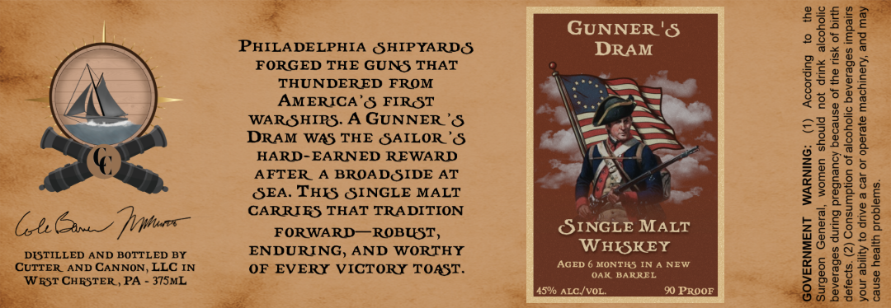

# TTB COLA Label Images - TTBID 26299001000278

**Brand Name:** GUNNER'S DRAM

**Issue Date:** 11/19/2026

**Origin Code:** 39

**Product Class/Type:** 140

**Source:** [TTB Public COLA Registry](https://ttbonline.gov/colasonline/viewColaDetails.do?action=publicFormDisplay&ttbid=26299001000278)

## Label Images

### Label 1

## Extracted Label Text

*Text extracted via OCR - may contain errors*

**Detected Proof:** 90

### Label 1

Cote ma [Yer

DISTILLED AND BOTTLED BY
(CurrER AND CANNON, LLC IN
Wr CHESTER, PA - 375ML

Bp

PHILADELPHIA SHIPYARDS
FORGED THE GUNS THAT
THUNDERED FROM
AMERICA’S FIRST
WARSHIRS. A GUNNER'S.
DRAM WAS THE SAILORS
HARD-EARNED REWARD
AFTER A BROADSIDE AT
GEA. THIS SINGLE MALT
CARRIRS THAT TRADITION
FORWARD—ROBUST,
ENDURING, AND WORTHY
OF EVERY VICTORY TOAST.

GUNNER'S

SI NGLE MALT
WHISKEY

AGED 6 MONTHS IN A NEW
‘OAK BARREL

45% ALC/ VOL.

20 PROOF

2
5
2

2,
2B

8
<

Government WARNING:

furgeon General, women should not drink alcoholic
beverages during pregnancy because of the risk of birth

defects. (2) Consumption of alcoholic beverages impairs

drive a car or operate machinery, and may

problems.
