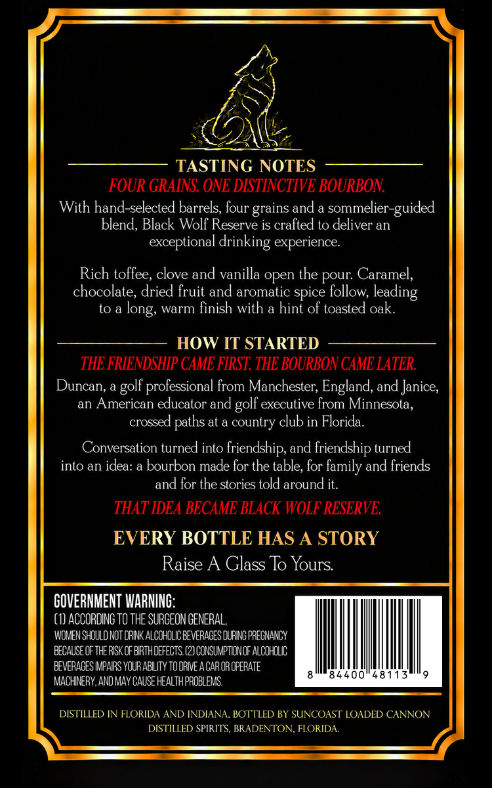
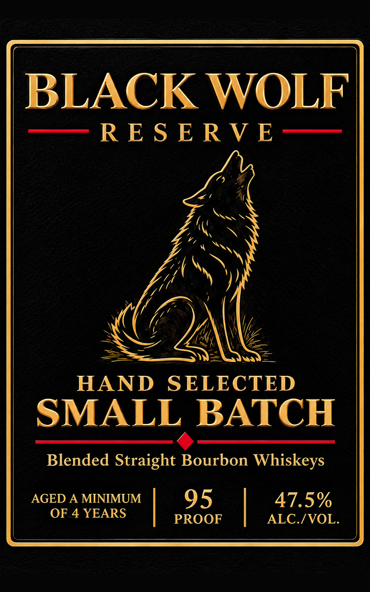

# TTB COLA Label Images - TTBID 26299001000299

**Brand Name:** BLACK WOLF RESERVE

**Issue Date:** 10/29/2026

**Origin Code:** 16

**Product Class/Type:** 121

**Source:** [TTB Public COLA Registry](https://ttbonline.gov/colasonline/viewColaDetails.do?action=publicFormDisplay&ttbid=26299001000299)

## Label Images

### Back Label

### Front Label

## Extracted Label Text

*Text extracted via OCR - may contain errors*

**Detected Proof:** 95
**Detected Age:** 4 Years

### Back Label

TASTING NOTES
FOUR GRAINS: ONE DISTINCTIVE BOURBON
With hand-selected barrels, four grains and a sommelier-guided
blend, Black Wolf Reserve is crafted to deliver an
exceptional drinking experience
Rich toffee; clove and vanilla open the pour: Caramel,
chocolate, dried fruit and aromatic spice follow;
to &
warm finish
a hint of toasted oak
HOW IT STARTED
THE FRIENDSHIP CAME FIRST; THE BOURBON CAME LATER
Duncan; a
'professional from Manchester; England; and Janice;
an American educator and
executive from Minnesota,
crossed
at &
country club in Florida:
Conversation turned into friendship, and friendship turned
into an idea: & bourbon made for the table; for family and friends
and for the stories told around it.
THAT IDEA BECAME BLACK WOLF RESERVE:
EVERY BOTTLE HAS A STORY
Raise A Glass To Yours
GOVERNMENT WARNING:
(1) ACCORDING TO THE SURGEON GENERAL,
WOMEN SHOULD NOT oRINK ALCOHOLIC BEVERAGES DURNG PRECNANCY
EECAUSE OF THE RSK OF BRTHDEFECTS (2) CONSUMPTIONOF ALCoHOLIc
EEVERACES IPARS YOUR ABILITY TODRIE ACAROR OPERATE
84400"48113
MACHINERY.AND MAv CAUSE HEALTHPROBLEMS
DISTILLED IN FLORIDA AND INDIANA BOTTLED BY SUNCOAST LOADED CANNON
DISTILLED SPIRITS, BRADENTON, FLORIDA
leading
long;
with
golf |
golf =
paths

### Front Label

BLACK WOLF
RE S E RVE
HAND
SELECTED
SMALL
BATCH
Blended Straight Bourbon Whiskeys
AGED A MINIMUM
95
47.5%
OF 4 YEARS
PROOF
ALC /VOL.
