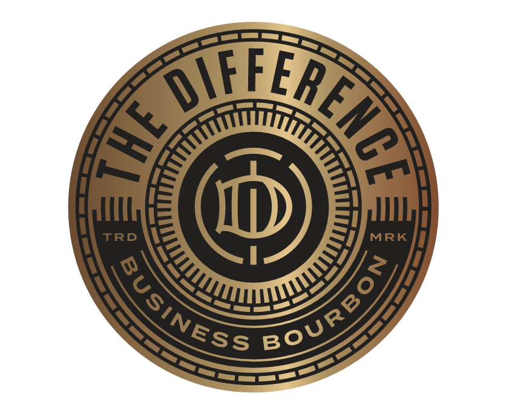
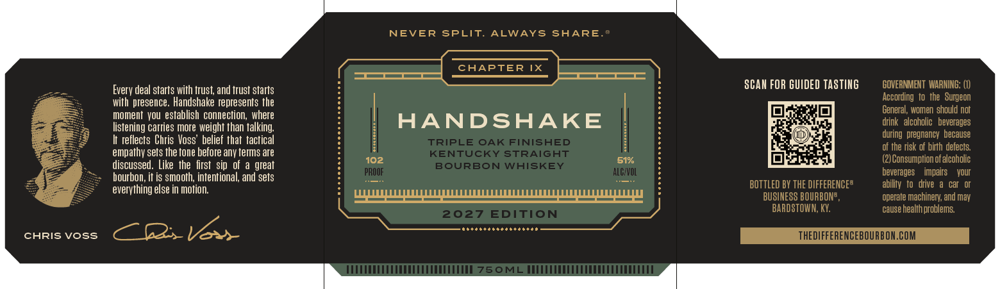

# TTB COLA Label Images - TTBID 26299001000322

**Brand Name:** THE DIFFERENCE BUSINESS BOURBON

**Issue Date:** 11/04/2026

**Origin Code:** 22

**Product Class/Type:** 101

**Source:** [TTB Public COLA Registry](https://ttbonline.gov/colasonline/viewColaDetails.do?action=publicFormDisplay&ttbid=26299001000322)

## Label Images

### Label 1

### Label 2

### Label 3

## Extracted Label Text

*Text extracted via OCR - may contain errors*

**Detected Proof:** 102

### Label 1

TRD
MRK
XEHETG
DIFE
4
RoURBo)
RUSINESS

### Label 2

NEVER
SPLIT
ALWAYS
SHARE
CHAPTER IX
Everv deal starts with trust, and trust starts
SCAH FOR GUIDED TASTIKG
GOVERMMENT  WARNING: (I)
with presence . Handshake represents the
According   to   the   Surgeon
moment  VOU  establish  connection, where
General, women should not
listening carries more weight than talking
HANDSHAKE
drink   alcoholic   beverages
during   pregnancy  because
reflects Chris Voss' belief that  tactical
TRIPLE OAK FINISHED
of the risk of birth defects
empathy sets the tone before any terms are
KENTUCKY
STRAIGHT
discussed . Like   the   first  sip   of a great
102
BOURBON WHISKEY
51%
Consumption ofalcoholic
PROOF
ALCVOL
beverages
impairs
Vour
bourbon; it is smooth, intentional; and sets
else
motion.
BOTTLED BY THE DIFFERENCEE
ability
t0   drive &
everything
BUSINESS BOURBONE
operate machinery; and may
2027
EDITION
BARDSTOWN, KY:
cause
health problems
CHRIS Voss
SEV
THEDIFFERENCEBOURBON.COM
760ML

### Label 3

TIN
NEVER SPLIT.
ALWAYS SHARE.”

PIU UPUUORORU MOO UOROUORURUOCOUI ODOT OOOO UOUUOUUIUORU UOTE UTOUOUOROUO RU OT UGE
