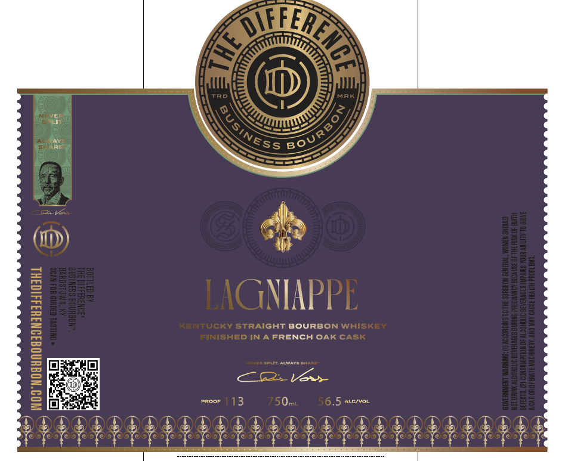
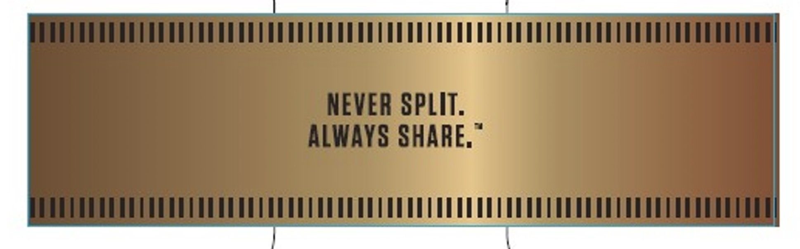

# TTB COLA Label Images - TTBID 26299001000327

**Brand Name:** THE DIFFERENCE BUSINESS BOURBON

**Issue Date:** 10/29/2026

**Origin Code:** 22

**Product Class/Type:** 101

**Source:** [TTB Public COLA Registry](https://ttbonline.gov/colasonline/viewColaDetails.do?action=publicFormDisplay&ttbid=26299001000327)

## Label Images

### Label 1

### Label 2

## Extracted Label Text

*Text extracted via OCR - may contain errors*

*1 image(s) excluded: text did not meet readability threshold*

### Label 1

0
P
MRK
3
1
1
1
3
3
LAGNIAPPE
]
1
#
1
0
1
3
KENTUCKY StrAIGHT BOURBON WHISKEY
|
FINISHED IN A FRENCH OAK CaSK
1
1
EE EELT ALWNATE GHAA
362
Ves
1
BE
EDOi
113
750mL
56.5
ALC VOI
E:
SHHTNA
H
BouRbo >
USINESS
