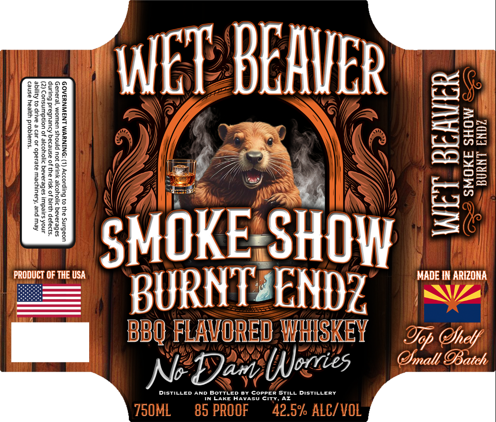
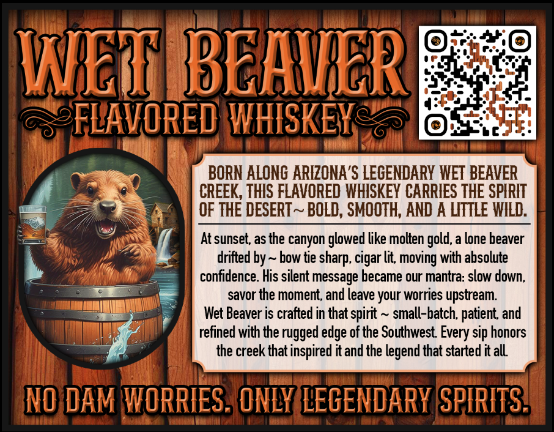

# TTB COLA Label Images - TTBID 26299001000359

**Brand Name:** WET BEAVER

**Fanciful Name:** BURNT ENDZ BBQ FLAVORED WHISKEY

**Issue Date:** 10/29/2026

**Origin Code:** 11

**Product Class/Type:** 149

**Source:** [TTB Public COLA Registry](https://ttbonline.gov/colasonline/viewColaDetails.do?action=publicFormDisplay&ttbid=26299001000359)

## Label Images

### Label 1

### Label 2

## Extracted Label Text

*Text extracted via OCR - may contain errors*

### Label 1

gSosze

SRBOO

WET BEAVER

Se ee)

Eos

mz

fo

CeO WE

os

|

MOKE: SHO

MADE IN ARIZONA

BURNTZEND?Z

LAVORED WHiSKeY

Lop Drclf

| BBQ F

Doan (Mos

Yall Patch

me

DISTILLED AND BOTTLED BY COPPER STILL DISTILLERY

IN LAKE Havasu CiTy, AZ

### Label 2

WRTE BBEHHERE
2FLAVORED WHISKEKe&
BORN ALONG ARIZONA'S LEGENDARY WET BEAVER
CREEK, THIS FLAVORED WHISKEY CARRIES THE SPHRHT
OF THE DESERT ~ BOLD, SMOOTH, AND A LITTLE WILD:
At sunset as the canyon glowed like molten gold, a lone beaver
drifted by
bow tie
cigar lit moving with absolute
confidence. His silent message became our mantra: slow down;
savor the moment; and [eave your worries upstream
Wet Beaver is crafted in that spirit
small-batch; patient;
refined with the rugged edge of the Southwest
sip honors
the creek that inspired it and the legend that started it all
MO dAM WORRIES _ ONLY LEGENDARY SPIRITS}
sharp;
and
Every :
