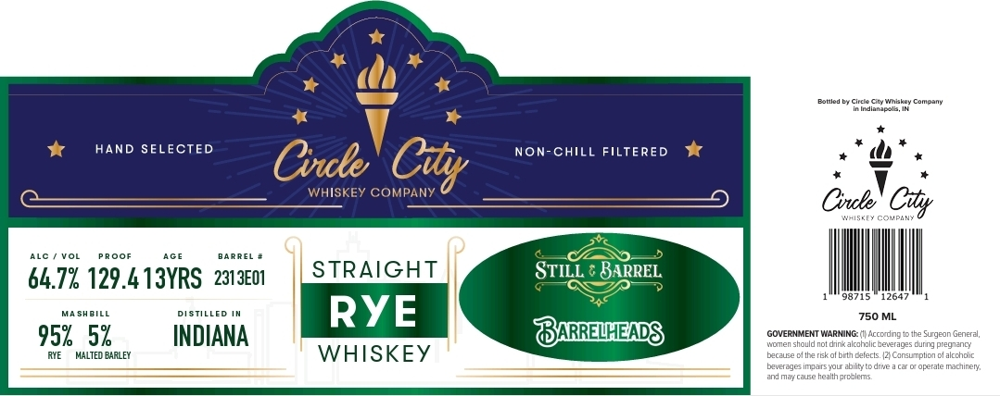

# TTB COLA Label Images - TTBID 26299001000361

**Brand Name:** CIRCLE CITY WHISKEY COMPANY

**Issue Date:** 10/29/2026

**Origin Code:** 19

**Product Class/Type:** 102

**Source:** [TTB Public COLA Registry](https://ttbonline.gov/colasonline/viewColaDetails.do?action=publicFormDisplay&ttbid=26299001000361)

## Label Images

### Label 1

## Extracted Label Text

*Text extracted via OCR - may contain errors*

**Detected Age:** 13 Years

### Label 1

Fanlea
cirk Cy Ymekes
Comonny
In Ir Jinnapoiz; IN
HAND SELECTED
Non-CHIll FILTERED
Cvule
WHISKEY COMPANY
Cnule " Cty
J547
Covpin?
@a F
SRAEL
64.7% 129.4 13YRS   2313E01
STRAIGHT
STILL : BARREL
98715
12647
MASHBIL
DISTILLED
RYE
750 ML
952   5%
INDIANA
BARREIENDS
GOVERNMENT WARNING
fcccrding
generzl
Tomen shovid noldnn-aicjnjiic je 2r1025
przonenc;
MALTED BARLEY
WHISKEY
baczuze cl Iha rEkof bitn Czfects.
Circumpic7cidiccnciic
DZvEledes Imjars 'OU ebllc'tC dnve 3 Czr
operale Tagjinen
Znimiy Czue heakh orc7lems
Cty
Sugeo"
Djing
