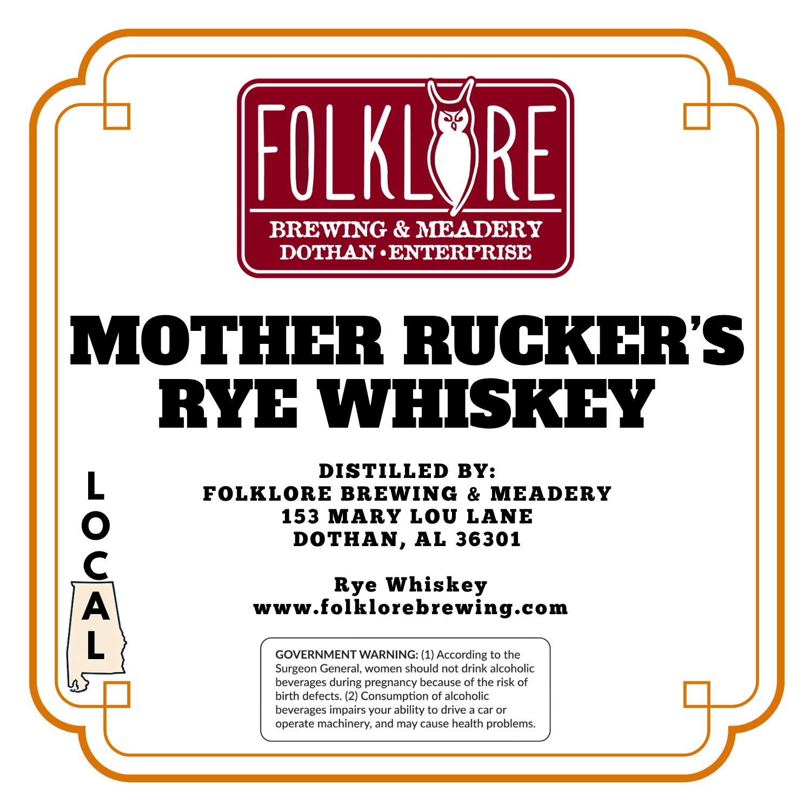
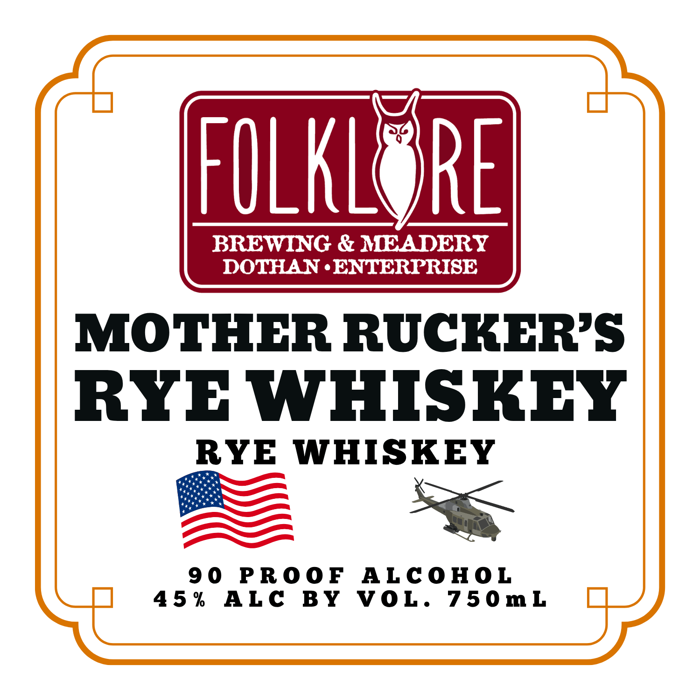

# TTB COLA Label Images - TTBID 26299001000367

**Brand Name:** MOTHER RUCKER'S RYE WHISKEY

**Issue Date:** 10/29/2026

**Origin Code:** 10

**Product Class/Type:** 142

**Source:** [TTB Public COLA Registry](https://ttbonline.gov/colasonline/viewColaDetails.do?action=publicFormDisplay&ttbid=26299001000367)

## Label Images

### Back Label

### Front Label

## Extracted Label Text

*Text extracted via OCR - may contain errors*

### Back Label

FOLKLE
RE
BREWING & MEADERY
DOTHAN
ENTERPRISE
MOTHER RUCKERS
RYE WHISKEY
DISTILLED BY:
FOLKLORE BREWING
& MEADERY
153
MARY LOU
LANE
DOTHAN,
AL 36301
1
www foifioeiseeing com
GOVERNMENT WARNING: (1) According to the
Surgeon General, women should not drink alcoholic
beverages during pregnancy because of the risk of
birth defects. (2) Consumption of alcoholic
beverages impairs your ability to drive a car or
operate machinery, and may cause health problems_

### Front Label

FULKLE
RE
BREWING & IEADERY
DOTHAN
ENTERPRISE
MOTHER RUCKHRS
RYE WHISKEY
RYE
WHISKEY
9 0
PRo0F
ALcoHOL
4 5 %
ALC
BY
VOL.
7 5 0m L
