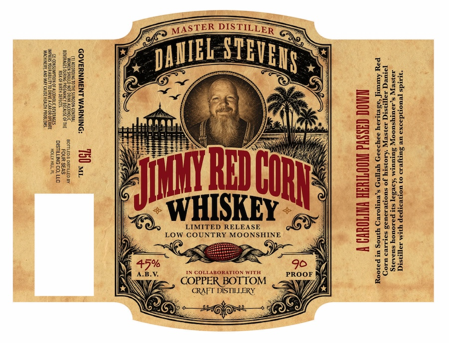

# TTB COLA Label Images - TTBID 26299001000398

**Brand Name:** DANIEL STEVENS

**Fanciful Name:** JIMMY RED CORN WHISKEY

**Issue Date:** 10/29/2026

**Origin Code:** 16

**Product Class/Type:** 140

**Source:** [TTB Public COLA Registry](https://ttbonline.gov/colasonline/viewColaDetails.do?action=publicFormDisplay&ttbid=26299001000398)

## Label Images

### Front Label

## Extracted Label Text

*Text extracted via OCR - may contain errors*

**Detected Proof:** 90

### Front Label

0
Hu
0

H
=
0
M
I
|
1
H
0

2
Rh
#
6
J
WHISKEY
LIMITED RELEASE
U
H
Low
COUNTRY MOONSHINE
@j
1
45%
90
J
COLLABORATION WTTH
A.B.V
PROOF
COPPER BOTTOM
CRAFT DISTILERY
MASTER
DISTILLER
STEVEHP
DAMIEL

COHT
I
