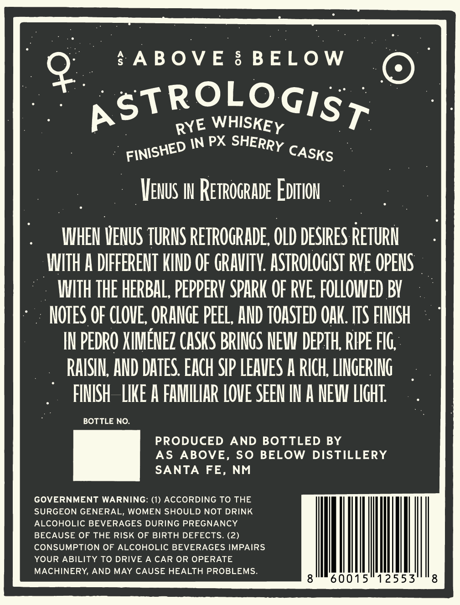
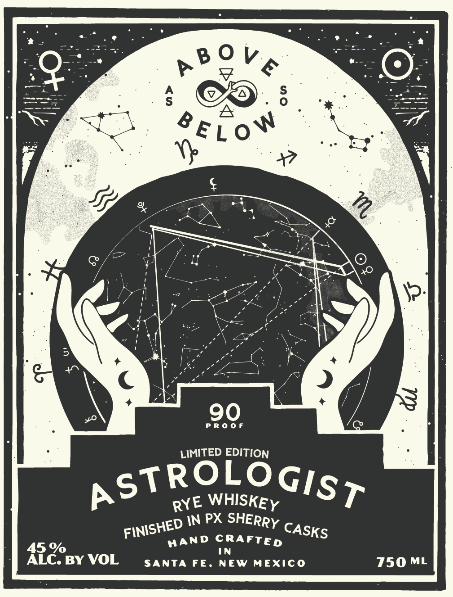
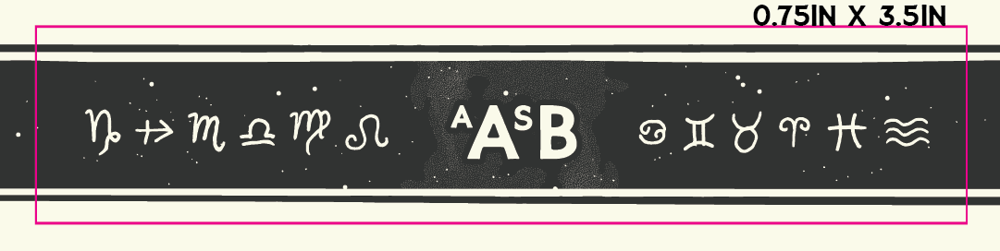

# TTB COLA Label Images - TTBID 26299001000478

**Brand Name:** ASTROLOGIST

**Issue Date:** 10/29/2026

**Origin Code:** 34

**Product Class/Type:** 142

**Source:** [TTB Public COLA Registry](https://ttbonline.gov/colasonline/viewColaDetails.do?action=publicFormDisplay&ttbid=26299001000478)

## Label Images

### Back Label

### Front Label

### Label 3

## Extracted Label Text

*Text extracted via OCR - may contain errors*

### Back Label

bABOVE

BELOW

4

ROLOG

pot

XE WHISKEY

Isr

yntsheD IN PX SHERRY cy 5

VENUS IN RETROGRADE EDITION

WHEN VENUS TURNS RETROGRADE, OLD DESIRES RETURN

WITH A DIFFERENT KIND OF GRAVITY. ASTROLOGIST RYE OPENS

WITH THE HERBAL, PEPPERY SPARK OF RVE, FOLLOWED BY

NOTES OF CLOVE, ORANGE PEEL, AND TOASTED OAK. ITS FINISH

IN PEDRO XIMENEZ CASKS BRINGS NEW DEPTH, RIPE FIG

RAISIN, AND DATES. EACH SIP LEAVES A RICH, LINGERING

FINISH LIKE A FAMILIAR LOVE SEEN IN A NEW LIGHT,

BOTTLE NO.

PRODUCED AND BOTTLED BY

AS ABOVE, SO BELOW DISTILLERY

=

SANTA FE, NM

GOVERNMENT WARNING: (1) ACCORDING TO THE

SURGEON GENERAL, WOMEN SHOULD NOT DRINK

BECAUSE OF THE RISK OF BIRTH DEFECTS. (2

ALCOHOLIC BEVERAGES DURING PREGNANCY

CONSUMPTION OF ALCOHOLIC BEVERAGES IMPAIRS

YOUR ABILITY TO DRIVE A CAR OR OP!

MACHINERY, AND MAY CAUSE HEALTH PROBLEMS

8

|

60015

|

12553

8

### Front Label

Lao

_*

—s)

Bea

BOVE,

——

a;

CO

SEL oN

iy

&

yw AL,

JS

o/*

7

\?

va

K

+ @

PROOF

i

LIMITED EDITION

ROLOG

ps

RYE WHISKEY

Isp

FINISH!

\3

DIN PX SHERRY cag

4

9

WAND CRAFTED

ALC

BY VOL

SANTA FE, NEW MEXICO

750 ML

### Label 3

pe _TSIN X SSINS
 BenaRrsn AASB axyris
[eee os eee
