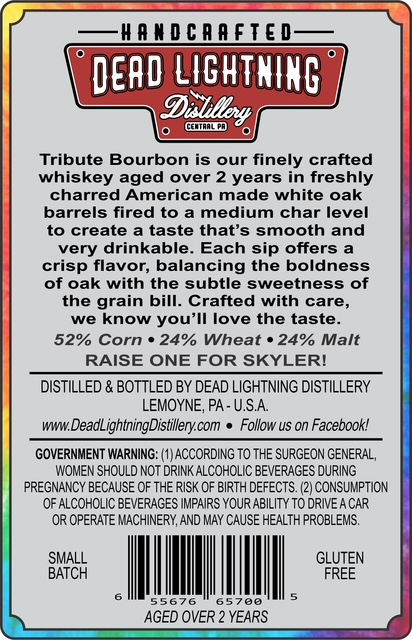
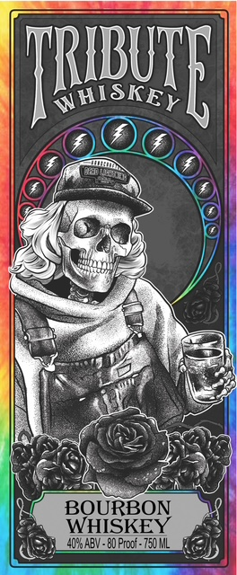

# TTB COLA Label Images - TTBID 26299001000522

**Brand Name:** TRIBUTE

**Issue Date:** 10/29/2026

**Origin Code:** 39

**Product Class/Type:** 141

**Source:** [TTB Public COLA Registry](https://ttbonline.gov/colasonline/viewColaDetails.do?action=publicFormDisplay&ttbid=26299001000522)

## Label Images

### Back Label

### Front Label

## Extracted Label Text

*Text extracted via OCR - may contain errors*

*1 image(s) excluded: text did not meet readability threshold*

**Detected Age:** 2 Years

### Back Label

handGAAELED S
dead LIchTnIng
coantpo
Tribute Bourbon is
our
finely crafted
whiskey aged over 2 years in freshly
charred American made white oak
barrels fired to a medium char level
to create
a taste that's smooth and
very drinkable
Each sip offers a
crisp flavor; balancing the boldness
of oak with the subtle sweetness of
the grain bill:
Crafted with care,
we know you'Il love the taste_
52% Corn
249 Wheat
249 Malt
RAISE ONE FOR SKYLERI
DISTILLED & BOTTLED BY DEAD LIGHTNING DISTILLERY
LEMOYNE, PA - U.SA
wwDeadLightningDistillery com
Follow us on Facebookl
GOVERNMENT WARNING=
ACCORDING TO THE SURGEON GENERAL ,
WOMEN SHOULD NOT DRINK ALCOHOLIC BEVERAGES DURING
PREGNANCY BECAUSE OF THE RISK OF BIRTH DEFECTS: (2) CONSUMPTION
OF ALCOHOLIC BEVERAGES IMPAIRS YOUR ABILITY TO DRIVE
CAR
OR OPERATE MACHINERY, AND MAY CAUSE HEALTH PROBLEMS_
GLUTEN
shTCH
FREE
AGED OVER =
YEARS
Dulilkoy,
