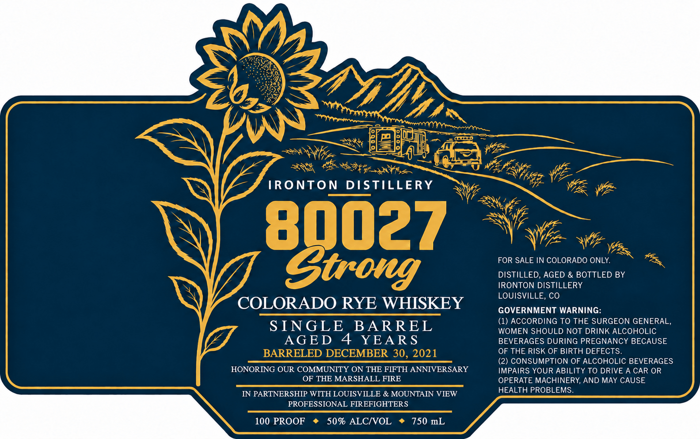

# TTB COLA Label Images - TTBID 26299001000542

**Brand Name:** 80027 STRONG

**Fanciful Name:** COLORADO RYE WHISKEY

**Issue Date:** 10/29/2026

**Origin Code:** 13

**Product Class/Type:** 142

**Source:** [TTB Public COLA Registry](https://ttbonline.gov/colasonline/viewColaDetails.do?action=publicFormDisplay&ttbid=26299001000542)

## Label Images

### Label 1

## Extracted Label Text

*Text extracted via OCR - may contain errors*

**Detected Proof:** 100

### Label 1

IRONTON
DISTILLERY
80027
FOR SALE IN COLORADO ONLY:
4
Gtrong
DISTILLED, AGED & BOTTLED BY
IRONTON DISTILLERY
LOUISVILLE, CO
COLORADO RYE WHISKEY
GOVERNMENT WARNING:
(1) ACCORDING TO THE SURGEON GENERAL_
S INGLE
BARREL
WOMEN SHOULD NOT DRINK ALCOHOLIC
AGED
4
YEA RS
BEVERAGES DURING PREGNANCY BECAUSE
BARRELED DECEMBER 30, 2021
OF THE RISK OF BIRTH DEFECTS.
(2) CONSUMPTION OF ALCOHOLIC BEVERAGES
HONORING OUR COMMUNITY ON THE FIFTH ANNIVERSARY
IMPAIRS YOUR ABILITY TO DRIVE A CAR OR
OF THE MARSHALL FIRE
OPERATE MACHINERY, AND MAY CAUSE
IN PARTNERSHIP WITH LOUISVILLE
& MOUNTAIN VIEW
HEALTH PROBLEMS.
PROFESSIONAL FIREFIGHTERS
100 PROOF
50% ALCIVOL
750 mL
Yfentnt
Va #
W Y
