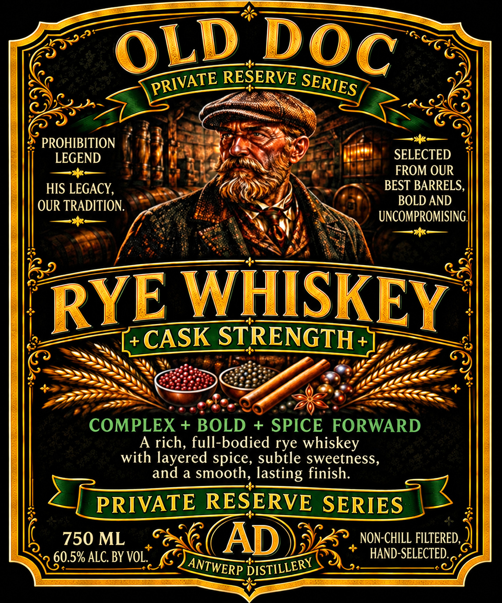
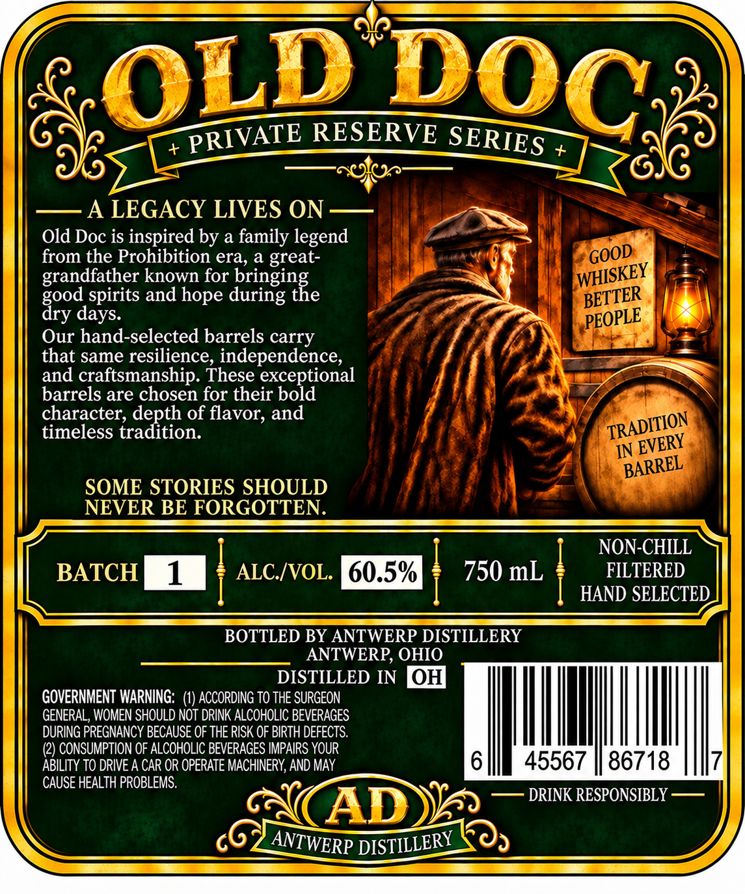

# TTB COLA Label Images - TTBID 26299001000557

**Brand Name:** ANTWERP DISTILLERY

**Issue Date:** 11/05/2026

**Origin Code:** 09

**Product Class/Type:** 142

**Source:** [TTB Public COLA Registry](https://ttbonline.gov/colasonline/viewColaDetails.do?action=publicFormDisplay&ttbid=26299001000557)

## Label Images

### Label 1

### Label 2

## Extracted Label Text

*Text extracted via OCR - may contain errors*

**Detected Proof:** 121

### Label 1

RESERVE
PROHIBITION
LEGEND
SELECTED
FROM OUR
HIS LEGACY,
BEST BARRELS,
OUR TRADITION.
BOLD AND
UNCOMPROMISING;
WHSKEY
CASK STRENGTH
+
COMPLEX + BOLD
+
SPICE
FORWARD
A rich, full-bodied rye whiskey
with layered spice, subtle sweetness,
and a smooth, lasting finish:
PRIVATE RESERVE SERIES
750 ML
AD
NON-CHILL FILTERED,
60.5% ALC. BY VOL.
HAND-SELECTED.
OLD
DOC
PRIVATE
SERIES
RYE
DISTILLERY
ANTWERP

### Label 2

RESERVE
+
+
A LEGACY LIVES ON
Old Doc is inspired by a family legend
from the Prohibition era, a great-
grandfather known for
drignge
spirits and hope during
Our hand-selected barrels carry
that same resilience, independence,
and craftsmanship. These
ir bordional
barrels are chosen for their
character; depth of flavor; and
timeless tradition:
IN
SOME STORIES SHOULD
NEVER BE FORGOTTEN.
NON-CHILL
BATCH
1
ALC /VOL:  60.5%
750 mL
FILTERED
HAND SELECTED
BOTTLED BY ANTWERP DISTILLERY
ANTWERP, OHIO
DISTILLED IN
OH
GOVERNMENT WARNING:   (1) ACCORDING TO THE SURGEON
GENERAL, WOMEN SHOULD NOT DRINK ALCOHOLIC BEVERAGES
DURING PREGNANCY BECAUSE OF THE RISK OF BIRTH DEFECTS.
(2) CONSUMPTION OF ALCOHOLIC BEVERAGES IMPAIRS YOUR
ABILITY TO DRIVE A CAR OR OPERATE MACHINERY, AND MAY
45567
86718
CAUSE HEALTH PROBLEMS.
DRINK RESPONSIBLY
AD
OLD
DOC
PRIVATE
SERIES
GOOD
WHISKEY
BETTER
good
days:
dry
PEOPLE
TRADITION
EVERY
BARREL
ANTWERP
DISTILLERY
