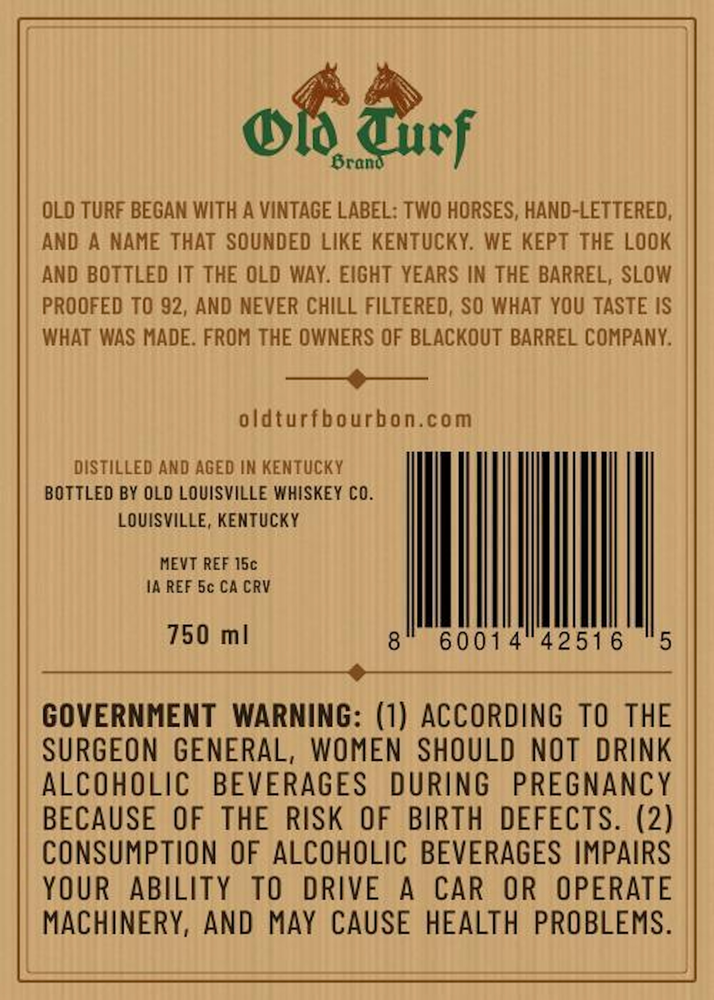
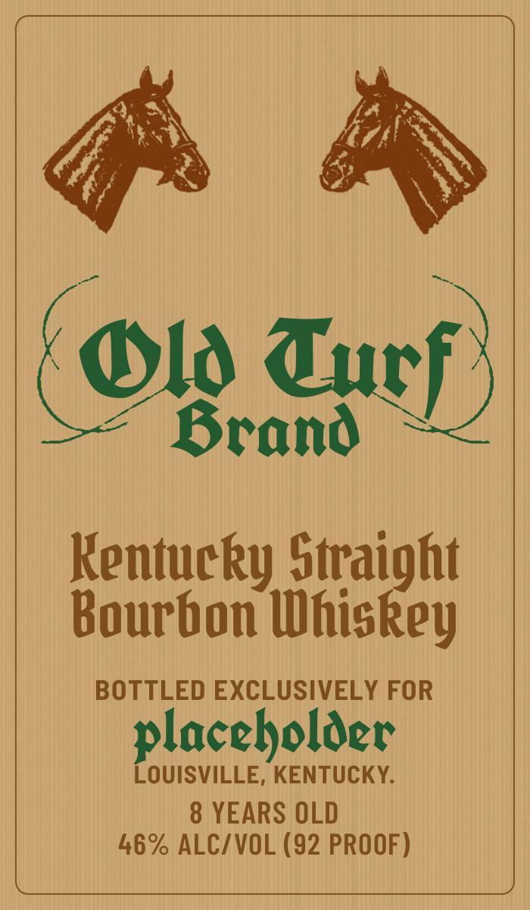

# TTB COLA Label Images - TTBID 26299001000710

**Brand Name:** OLD TURF

**Issue Date:** 10/29/2026

**Origin Code:** 22

**Product Class/Type:** 101

**Source:** [TTB Public COLA Registry](https://ttbonline.gov/colasonline/viewColaDetails.do?action=publicFormDisplay&ttbid=26299001000710)

## Label Images

### Back Label

### Front Label

## Extracted Label Text

*Text extracted via OCR - may contain errors*

**Detected Proof:** 92
**Detected Age:** 8 Years

### Back Label

of Bicy

OLO TURF BEGAN WITH A VINTAGE LABEL: TWO HORSES, HAND-LETTERED,
AND A NAME THAT SOUNDED LIKE KENTUCKY. WE KEPT THE LOOK
AND BOTTLED IT THE OLD WAY. EIGHT YEARS IN THE BARREL, SLOW
PROOFED TO 92, AND NEVER CHILL FILTERED, SO WHAT YOU TASTE IS
WHAT WAS MADE. FROM THE OWNERS OF BLACKOUT BARREL COMPANY.

———_———_
oldturfbourbon.com

DISTILLED AND AGED IN KENTUCKY
BOTTLED BY OLD LOUISVILLE WHISKEY CO.
LOUISVILLE, KENTUCKY
MEVT REF 15c
IA REF 5c CACRV

UIE ene teria ml

GOVERNMENT WARNING: LI A a ACCORDING TO THE
SURGEON GENERAL, WOMEN SHOULD NOT DRINK
ALCOHOLIC BEVERAGES DURING PREGNANCY
BECAUSE OF THE RISK OF BIRTH DEFECTS. (2)
CONSUMPTION OF ALCOHOLIC BEVERAGES IMPAIRS
YOUR ABILITY TO DRIVE A CAR OR OPERATE
MACHINERY, AND MAY CAUSE HEALTH PROBLEMS.

### Front Label

Ol Turf
Brand
Kentucky Straight
Bourbon Whiskey
BOTTLED EXCLUSIVELY FOR
placeholder
LOUISVILLE, KENTUCKY.
8 YEARS OLD
46% ALC/VOL (92 PROOF)
