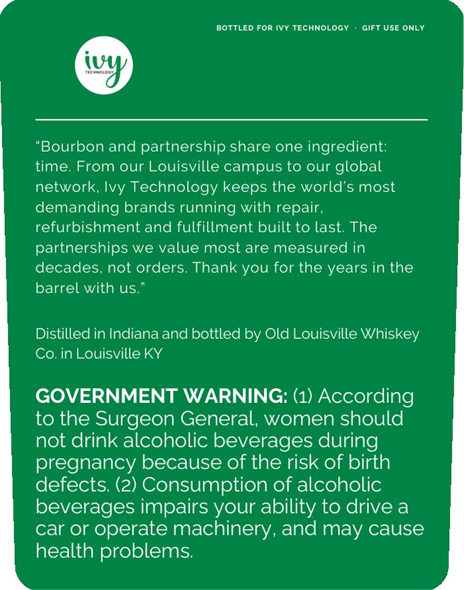
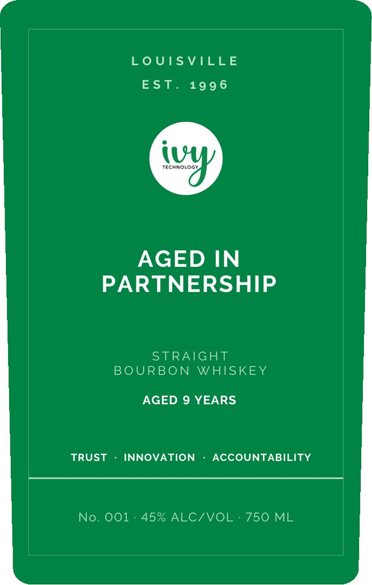

# TTB COLA Label Images - TTBID 26300001000142

**Brand Name:** IVY TECHNOLOGY

**Issue Date:** 10/30/2026

**Origin Code:** 22

**Product Class/Type:** 101

**Source:** [TTB Public COLA Registry](https://ttbonline.gov/colasonline/viewColaDetails.do?action=publicFormDisplay&ttbid=26300001000142)

## Label Images

### Back Label

### Front Label

## Extracted Label Text

*Text extracted via OCR - may contain errors*

**Detected Proof:** 90
**Detected Age:** 9 Years

### Back Label

BOTTLED FOR IvY TECHNOLOGY
Gift USE ONLY
iuw
"Bourbon and partnership share one ingredient:
time: From our Louisville campus to our
global
network; Ivy Technology keeps the world's most
demanding brands running with repair,
refurbishment and fulfillment built to last; The
partnerships we value most are measured in
decades, not orders: Thank you for the years in the
barrel with us.
Distilled in Indiana and bottled
Old Louisville Whiskey
Co. in Louisville KY
GOVERNMENT WARNING: (1) According
to the Surgeon General; women should
not drink alcoholic beverages during
pregnancy because of the risk of birth
defects: (2) Consumption of alcoholic
beverages impairs your ability to drive a
car or
operate machinery, and may cause
health problems:
by

### Front Label

LoUISVILLE
EST.
199 6
iuw
AGED
IN
PARTNERSHIP
STRAIGHT
BOURBON
WHISKEY
AGED 9 YEARS
TRUST
INNOVATION
ACCOUNTABILITY
No. 001
45% ALCIVOL
750 ML
