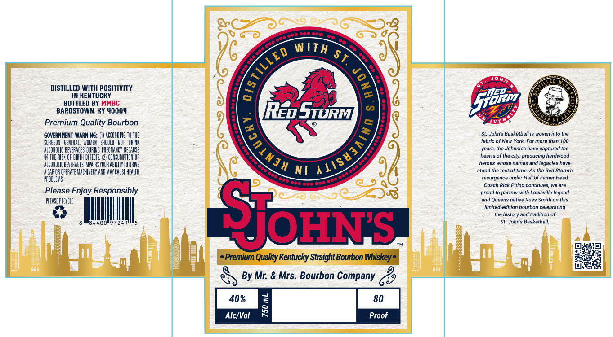
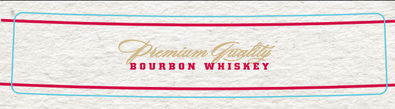

# TTB COLA Label Images - TTBID 26300001000174

**Brand Name:** MR. & MRS. BOURBON COMPANY

**Fanciful Name:** ST. JOHN'S UNIVERSITY

**Issue Date:** 10/29/2026

**Origin Code:** 22

**Product Class/Type:** 101

**Source:** [TTB Public COLA Registry](https://ttbonline.gov/colasonline/viewColaDetails.do?action=publicFormDisplay&ttbid=26300001000174)

## Label Images

### Front Label

### Label 2

### Label 3

## Extracted Label Text

*Text extracted via OCR - may contain errors*

*2 image(s) excluded: text did not meet readability threshold*

**Detected Proof:** 80

### Front Label

WITH
8}
DISTILLED WITH POSITIVITY
KENTUCKY
BOTTLED BY MMBC
BARDSTOWN, KY 40004
REbSiorM
O)
Premium Quality Bourbon
JVE#
GOVERNMENT WARNING: (VV AECOADIHG TO THE
St. Johns Basketball is woven into the
SURGEOK   GEMEHAL, WIMMEN   ShuuLU   HUT   #RIK
fabric of New York; For more than 100
ALCOHOUIC BEVEFHGES DUFIHG FAFG HANCY BFCAUSE
years, the Johnnies have captured the
THE RISK OF BIRTH DEFECTS (24 COHSUMPTIOH OF
hearts of the city; producing hardwood
ALCOHOLIC BENEHHGES IKPHIRS VOUR ABLLITY TU IHIE
heroes whose names and legacies have
A CAR OR OFERATE MACHIHEFK AXD MAY CauSe HEaLTh
N I
stood the test of time As the Red Storm's
PAOBLERE
resurgence under Hall of Famer Head
860
Coach Rlck Pitino continues;
We Are
Please Enjoy Responsibly
proud
partner with Louisville legend
FLeASE RECYELF
and Queens native Russ Smith on this
limited-edition bourbon celebrating
the history and tradition of
St, Johns Basketball:
Premium Quality Kentucky Straight Bourbon Whiskey
By Mr: & Mrs: Bourbon Company
40%
80
Alc/Vol
1
Proof
[
1
Si0rm
{
4118430)7
Sjors
