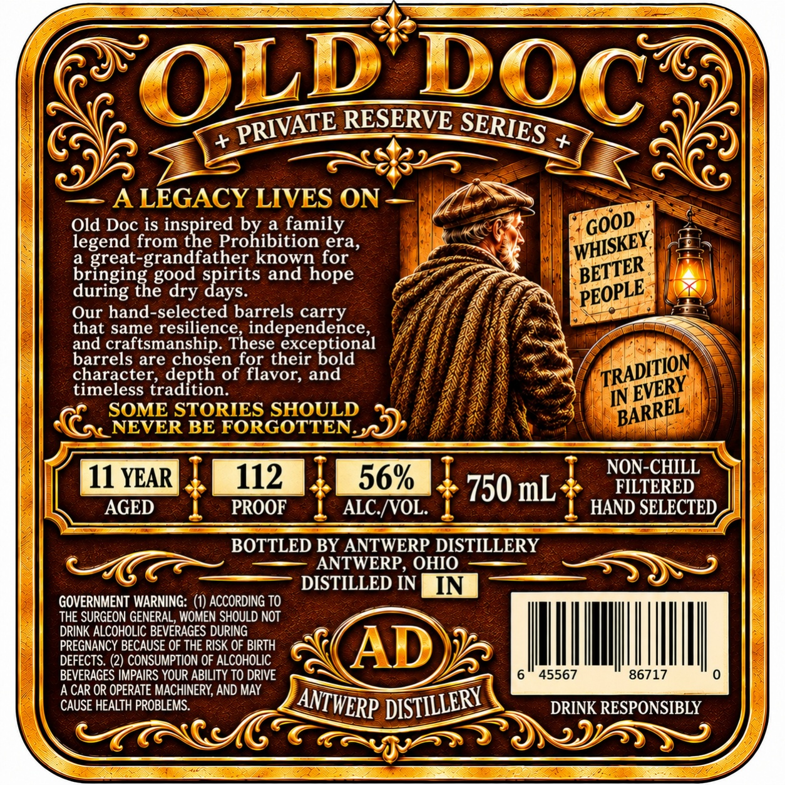
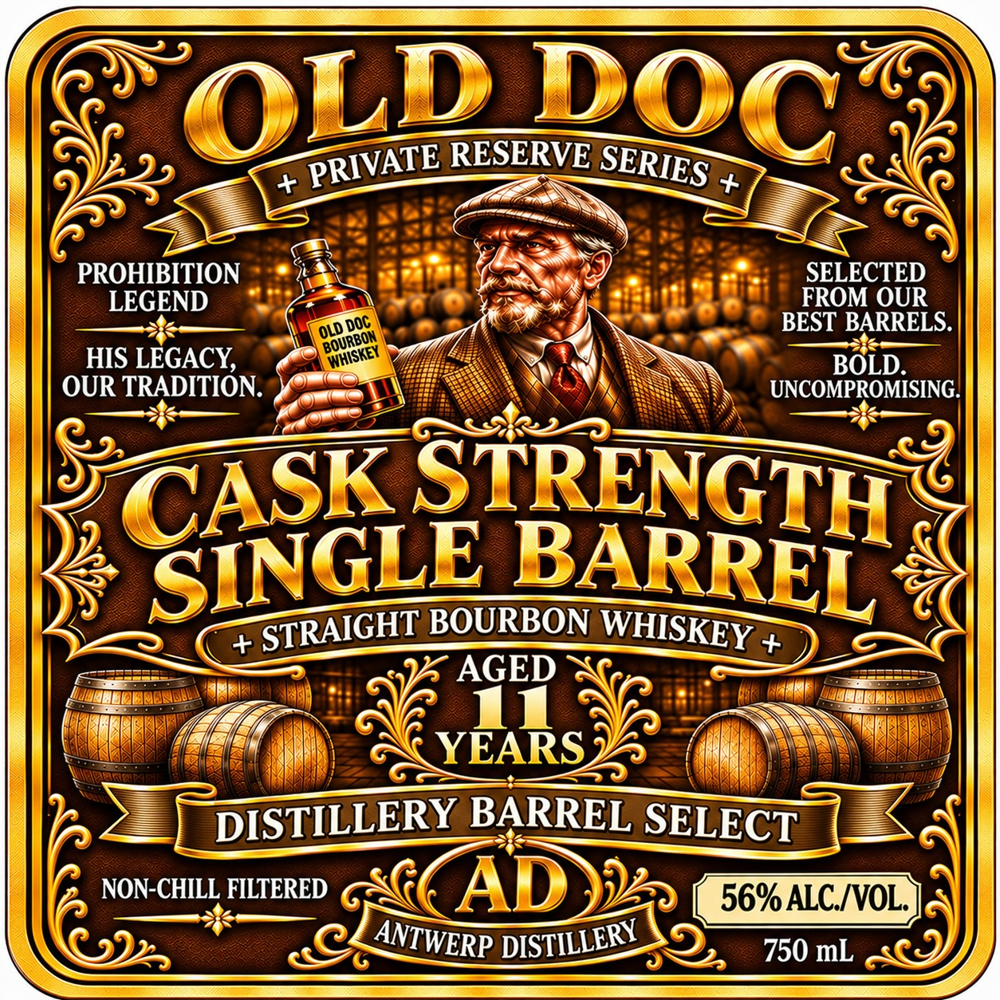

# TTB COLA Label Images - TTBID 26300001000182

**Brand Name:** ANTWERP DISTILLERY

**Issue Date:** 11/09/2026

**Origin Code:** 09

**Product Class/Type:** 101

**Source:** [TTB Public COLA Registry](https://ttbonline.gov/colasonline/viewColaDetails.do?action=publicFormDisplay&ttbid=26300001000182)

## Label Images

### Back Label

### Front Label

## Extracted Label Text

*Text extracted via OCR - may contain errors*

**Detected Proof:** 112
**Detected Age:** 11 Years

### Back Label

OLD
RESERVE
ALEGACY LIVES ON
Old Doc is inspired
ed bhibition
a
family
legend from the
a
great-grandfather known for
bringing
spirits and
during the
days.
Our hand-selected barrels carry
that same resilience, independence_
and craftsmanship. These
hecepoonal
barrels are chosen for their
character;
Traepiono
of flavor;
timeless
IN
SOME STORIES SHOULD
NEVER BE FORGOTTEN
NON-CHILL
11 YEAR
112
56%
750 mL
FILTERED
AGED
PROOF
ALC /VOL:
HAND SELECTED
BOTTLED BY ANTWERP DISTILLERY
ANTWERP , OHIO
DISTILLED IN
IN
GOVERNMENT WARNING: (1) ACCORDING TO
THE SURGEON GENERAL, WOMEN SHOULD NOT
DRINK ALCOHOLIC BEVERAGES DURING
PREGNANCY BECAUSE OF THE RISK OF BIRTH
AD
DEFECTS. (2) CONSUMPTION OF ALCOHOLIC
BEVERAGES IMPAIRS YOUR ABILITY TO DRIVE
45567
86717
A CAR OR OPERATE MACHINERY; AND MAY
CAUSE HEALTH PROBLEMS.
DRINK RESPONSIBLY
DOC
PRIVATE
SERIES
GOOD
WHISKEY]
era,
BETTER
good
hope
'PEOPLE
dry
TRADITION
and
EVERY
BARREL
DISTILLERY
ANTWERP

### Front Label

RESERVE
PROHIBITION
SELECTED
LEGEND
FROM OUR
BEST BARRELS:
HIS LEGACY,
BOLD_
OUR TRADITION.
UNCOMPROMISING.
STRENGTH
BOURBON
+
+
AGED
Tn
YEARS
DISTILLERY BARREL SELECT
NON-CHILL FILTERED
AD
56% ALCIVOL
750 mL
OLD
DOC
PRIVATE
SERIES
DOC
OLD "
BOURBON
WHISKEY
CASK
SINGLE
BARREL
STRAIGHT
WHISKEY
DISTILLERY
ANTWERP
