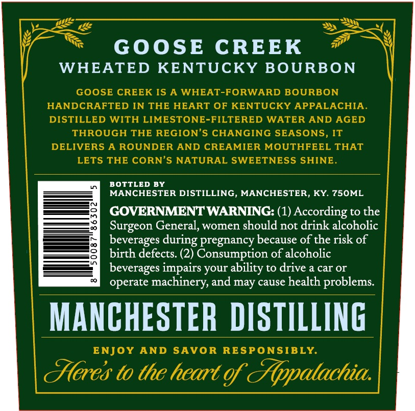
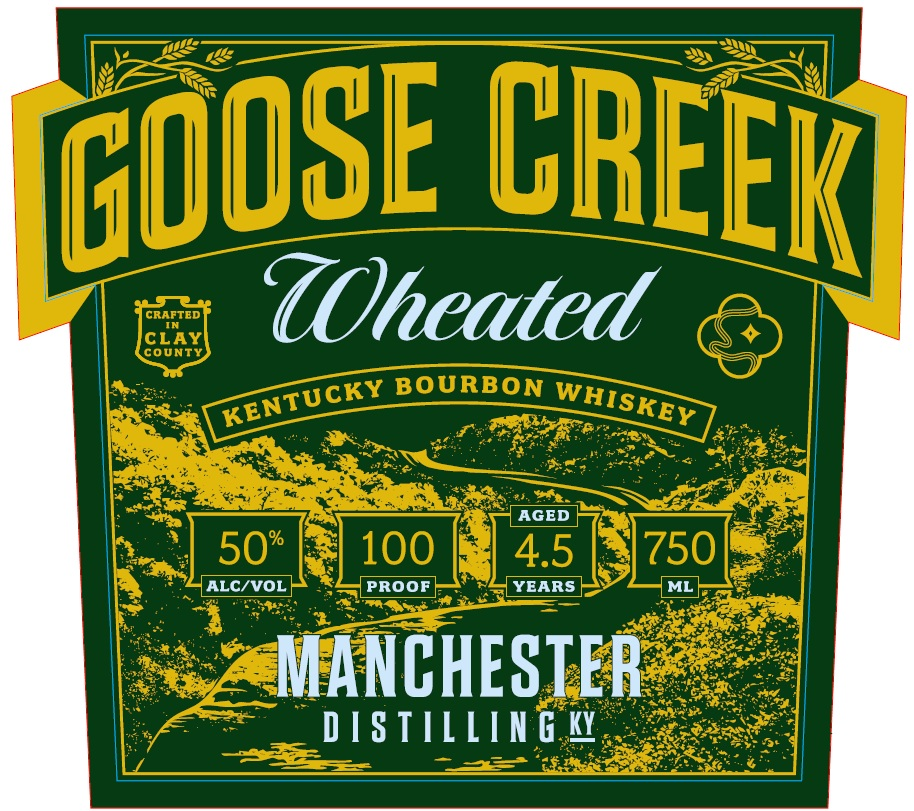

# TTB COLA Label Images - TTBID 26300001000212

**Brand Name:** GOOSE CREEK

**Issue Date:** 10/29/2026

**Origin Code:** 22

**Product Class/Type:** 141

**Source:** [TTB Public COLA Registry](https://ttbonline.gov/colasonline/viewColaDetails.do?action=publicFormDisplay&ttbid=26300001000212)

## Label Images

### Back Label

### Front Label

### Label 2

## Extracted Label Text

*Text extracted via OCR - may contain errors*

*1 image(s) excluded: text did not meet readability threshold*

### Back Label

GOOSE
CREEK
WHEATED KENTUCKY BOURBON
GOOSE CREEK IS A WHEAT-FORWARD BOURBON
HANDCRAFTED IN THE HEART OF KENTUCKY APPALACHIA
DISTILLED WITH LIMESTONE-FILTERED WATER AND AGED
THROUGH THE REGION'S CHANGING SEASONS, IT
DELIVERS
A ROUNDER AND CREAMIER MOUTHFEEL THAT
LETS THE CORN'S NATURAL SWEETNESS SHINE
BOTTLED BY
MANCHESTER DISTILLING, MANCHESTER, KY 75OML
GOVERNMENTWARNING: (1) According to the
Surgeon General, women should not drink alcoholic
beverages
pregnancy because of the risk of
birth defects: (2) Consumption of alcoholic
beverages impairs your
to drive a car or
operate machinery, and may cause health problems
MANCHESTER DISTILLING
ENJOY
AND
SAVOR
RESPONSIBLY
(eres to the heart gf TAppatachia
during
ability

### Front Label

CLZE
UOheated
coUNTY
BOURBON
AGED
%
50
100
4.5
750
ALC/VOL
PROOF
YEARS
ML
MANCHESTER
D[S TILLIN G W
CREEK
GOOSE
KENTUCKY
WHISKEY
