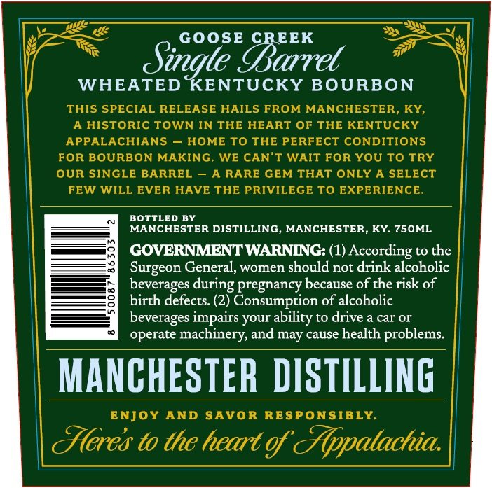
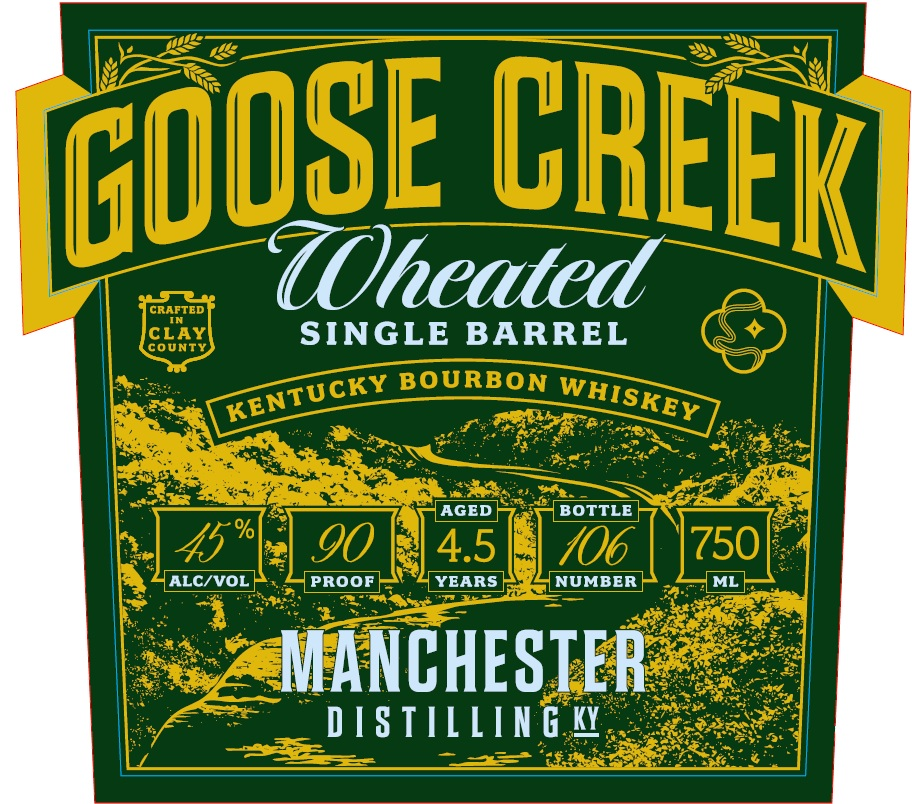

# TTB COLA Label Images - TTBID 26300001000217

**Brand Name:** GOOSE CREEK

**Fanciful Name:** SINGLE BARREL

**Issue Date:** 10/29/2026

**Origin Code:** 22

**Product Class/Type:** 141

**Source:** [TTB Public COLA Registry](https://ttbonline.gov/colasonline/viewColaDetails.do?action=publicFormDisplay&ttbid=26300001000217)

## Label Images

### Back Label

### Front Label

### Label 3

## Extracted Label Text

*Text extracted via OCR - may contain errors*

*1 image(s) excluded: text did not meet readability threshold*

### Back Label

GOOSE
CREEK
Sigte IBarret
WHEATED KENTUCKY BOURBON
THIS SPECIAL RELEASE HAILS FROM MANCHESTER, KY,
A HISTORIC TOWN IN THE HEART OF THE KENTUCKY
APPALACHIANS
HOME TO THE PERFECT CONDITIONS
FOR BOURBON MAKING
WE CAN'T WAIT FOR YOU To TRY
OUR SINGLE BARREL
~A RARE GEM THAT ONLY A SELECT
FEW WILL EVER HAVE THE PRIVILEGE TO EXPERIENCE
BOTTLED BY
MANCHESTER DISTILLING
MANCHESTER, KY. 750ML
GOVERNMENTWARNING: (1) According to the
Surgeon General, women should not drink alcoholic
beverages
pregnancy because of the risk of
birth defects: (2) Consumption of alcoholic
beverages impairs your ability to drive a car Or _
operate machinery,and may cause health problems
MANCHESTER DISTILLING
ENJOY AND SAVOR RESPONSIBLY
CHeres to the heart of &Appatachia:
during

### Front Label

CRAFTED
TOheated
CLAY
SINGLE
BARREL
COUNTY
BOURBON
AGED
BOTTLE
%
00
4.5
106
750
ALC/VOL
PROOF
YEARS
NUMBER
ML
MANCHESTER
D [ S TIIN G KY
CREER
GOOSE
KENTUCKY
WHISKEY
