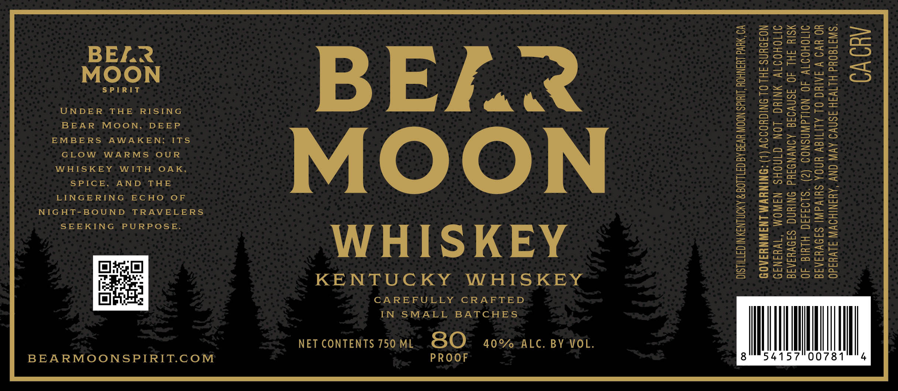

# TTB COLA Label Images - TTBID 26300001000265

**Brand Name:** BEAR MOON

**Issue Date:** 11/19/2026

**Origin Code:** 01

**Product Class/Type:** 140

**Source:** [TTB Public COLA Registry](https://ttbonline.gov/colasonline/viewColaDetails.do?action=publicFormDisplay&ttbid=26300001000265)

## Label Images

### Label 1

## Extracted Label Text

*Text extracted via OCR - may contain errors*

**Detected Proof:** 80

### Label 1

BELR
me — BEL
UNDER THE RISING ili, UN

BEAR MOON, DEEP

EMBERS AWAKEN; ITS
GLOW WARMS OUR
WHISKEY WITH OAK,
SPICE, AND THE

(1) ACCORDING TO THE SURGEON

LINGERING ECHO OF
NIGHT-BOUND TRAVELERS

KENTUCKY WHISKEY

CAREFULLY CRAFTED

IN SMALL BATCHES
NET CONTENTS 750 ML 80 40% ALC. BY VOL.
BEARMOONSPIRIT.COM PROOF 8°" 5415700781

DISTILLED IN KENTUCKY & BOTTLED BY BEAR MOON SPIRIT, ROHNERT PARK, CA
GENERAL, WOMEN SHOULD NOT DRINK ALCOHOLIC
BEVERAGES DURING PREGNANCY BECAUSE OF THE RISK
OF BIRTH DEFECTS. (2) CONSUMPTION OF ALCOHOLIC
BEVERAGES IMPAIRS YOUR ABILITY TO DRIVE A CAR OR
OPERATE MACHINERY, AND MAY CAUSE HEALTH PROBLEMS.

GOVERNMENT WARNING
