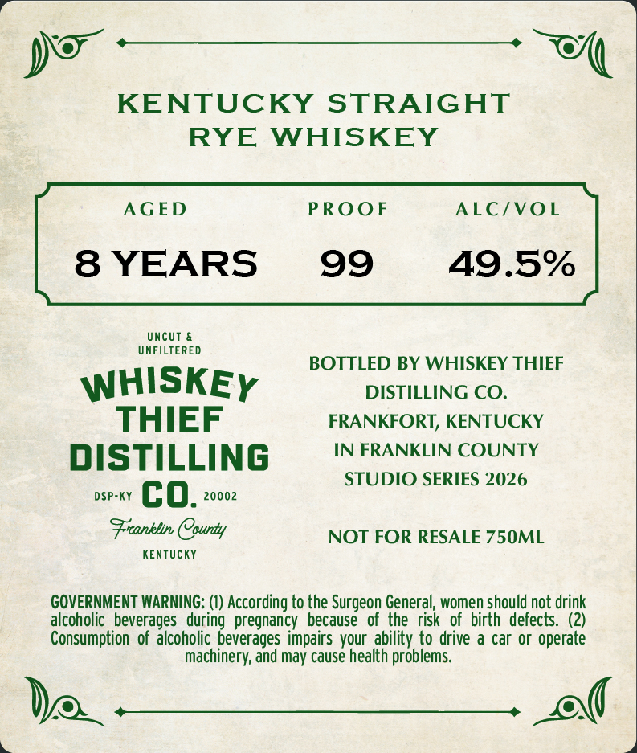
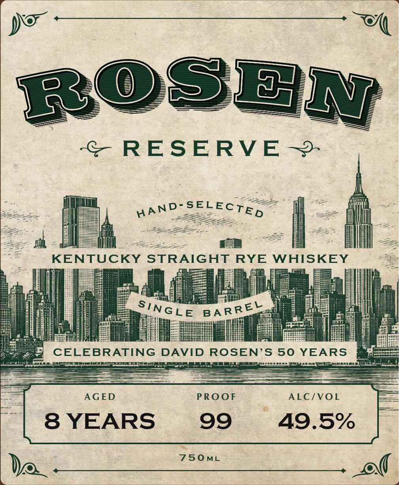

# TTB COLA Label Images - TTBID 26300001000331

**Brand Name:** WHISKEY THIEF DISTILLING CO.

**Fanciful Name:** ROSEN RESERVE

**Issue Date:** 10/30/2026

**Origin Code:** 22

**Product Class/Type:** 102

**Source:** [TTB Public COLA Registry](https://ttbonline.gov/colasonline/viewColaDetails.do?action=publicFormDisplay&ttbid=26300001000331)

## Label Images

### Back Label

### Front Label

## Extracted Label Text

*Text extracted via OCR - may contain errors*

**Detected Proof:** 99
**Detected Age:** 8 Years

### Back Label

KENTUCKY
STRAIGHT
RYE
WHISKEY
AGED
PROOF
ALC/VOL
8 YEARS
99
49.5%
UncUT
UNFILTERED
BOTTLED BY WHISKEY THIEF
WHISKEY
DISTILLING CO.
THIEF
FRANKFORT, KENTUCKY
DISTILLING
IN FRANKLIN COUNTY
STUDIO SERIES 2026
DSP-KY
co.
20002
Fronblin County
NOT FOR RESALE 750ML
KEnTUcKY
GOVERNMENT WARNING: (1) According to the Surgeon General, women should not drink
alcoholic   beverages   during   pregnancy
because
of the risk   of  birth  defects. (2)
Consumption   of alcoholic beverages impairs vour  ability to drive a car or operate
machinery; and may cause health problems

### Front Label

>,

DO

mH

LOSE

© RESERVE ~-

I

If

—

AND

SELEC;, —

if

il

il

Li

1

|

l

KENTUCKY STRAIGHT RYE Sebel sha

ail

SINGLE BARREX

Le

i

Be

etal

CELE ReING Bev ED ROSEN’S ae EARS

—————

Haass

tase

—

—

AGED

PROOF

ALC/VOL

8 YEARS

99

49.5%

7SOmL

Now

Pol

ep kg
