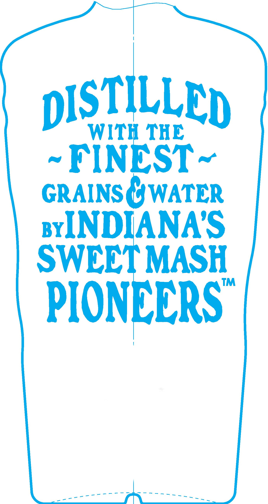
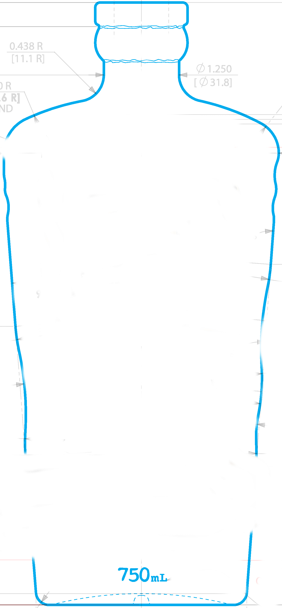
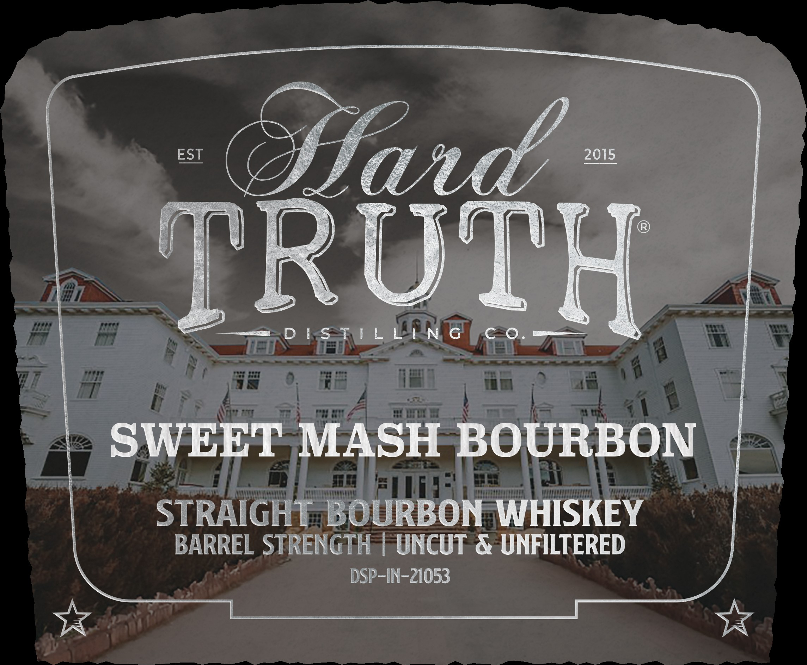
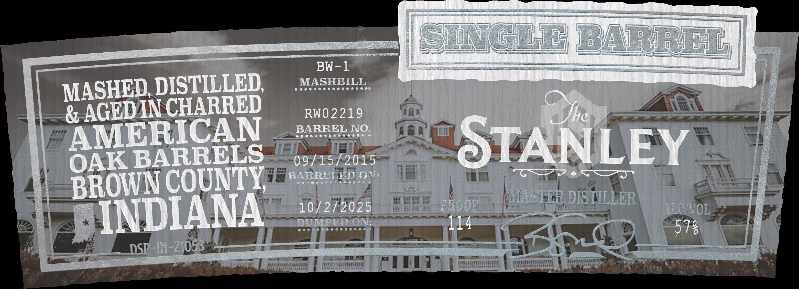
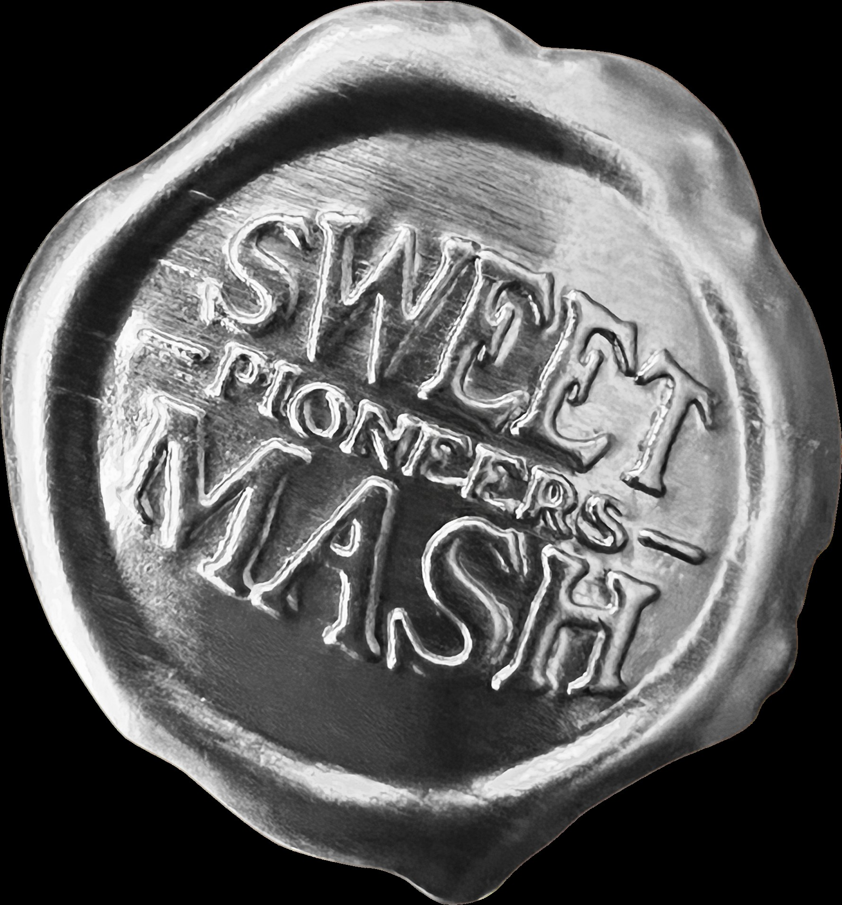

# TTB COLA Label Images - TTBID 26300001000338

**Brand Name:** HARD TURTH DISTILLING CO.

**Issue Date:** 10/30/2026

**Origin Code:** 19

**Product Class/Type:** 101

**Source:** [TTB Public COLA Registry](https://ttbonline.gov/colasonline/viewColaDetails.do?action=publicFormDisplay&ttbid=26300001000338)

## Label Images

### Back Label

### Front Label

### Label 1

### Label 2

### Label 6

## Extracted Label Text

*Text extracted via OCR - may contain errors*

*2 image(s) excluded: text did not meet readability threshold*

### Back Label

DISTILLED
WITH THE
FINEST
GRAINS CWATER
BYINDIANAS
SWEET MASH
TM
PIONEERS

### Label 1

EST
ffaed
2015
TRUTH
D ! S T i L LIN G
SWEET
MASH BOURBON
STRAIGHTABOURBON
WHISKEY
BARREL STRENGTH
UNCUT & UNFILTERED
DSP-IN-21053

### Label 2

SWG E BARRET
BW-1
MASHED DISTILLED
MASHBILL
& AGEDIN CHARRED
RW02219
he
AMERICAN
BARREL NO.
OAK BARRELS
09/15/2015
STANLEY
BROWN COUNTY
BARRELED ON:
10/2/2025
PROOr
HASTER DIS TILLER
ALCITOL
INDIANA
DUMPED ON:
114
578
DSP_IN-21053
