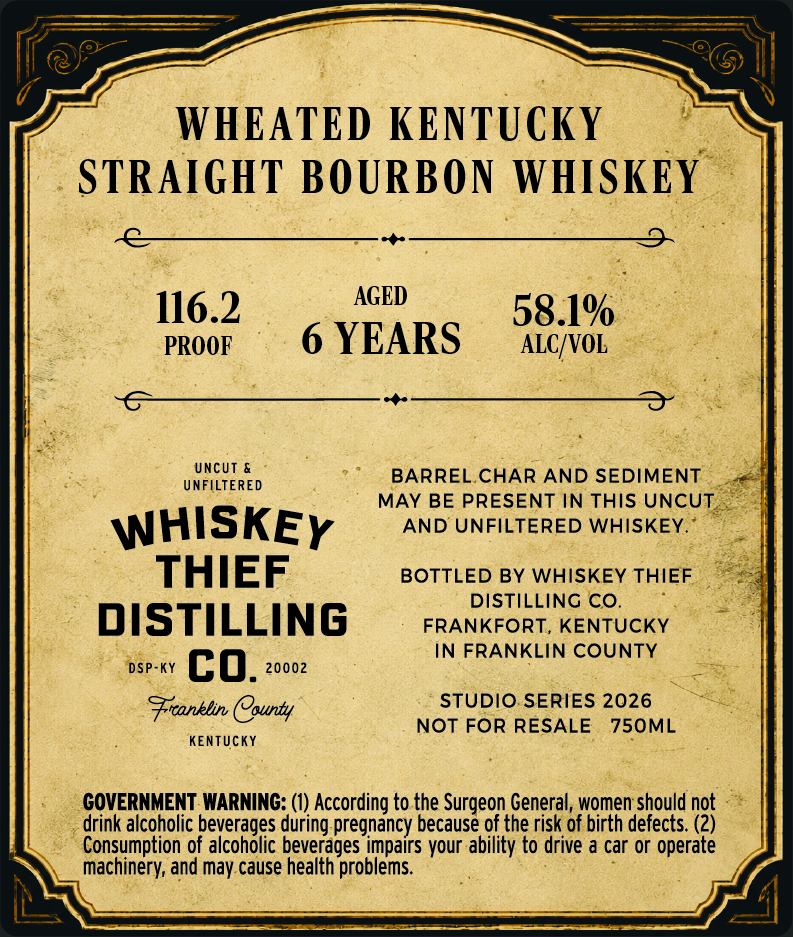
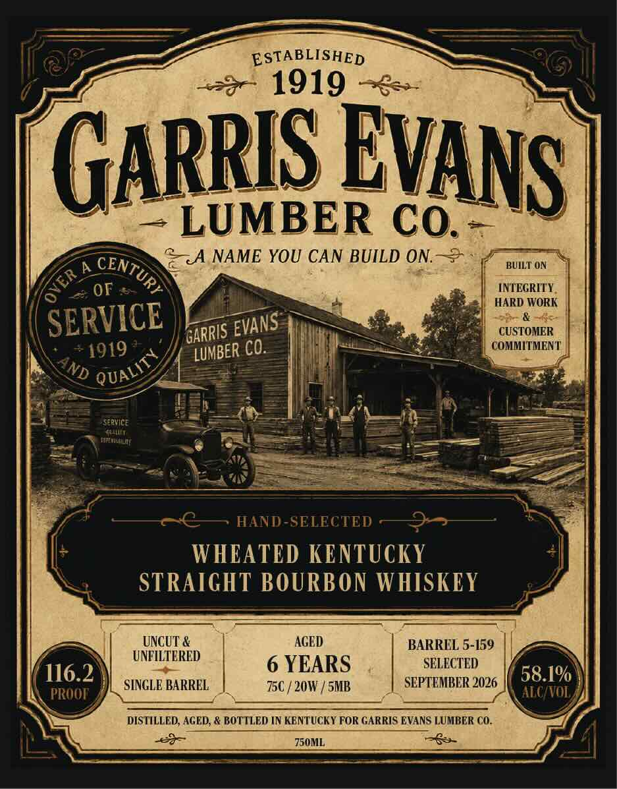
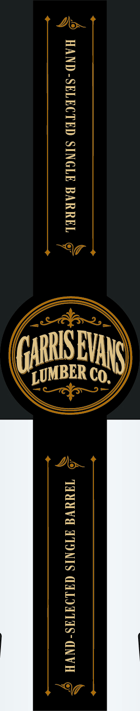

# TTB COLA Label Images - TTBID 26300001000339

**Brand Name:** WHISKEY THIEF DISTILLING CO.

**Fanciful Name:** GARRIS EVANS

**Issue Date:** 11/03/2026

**Origin Code:** 22

**Product Class/Type:** 101

**Source:** [TTB Public COLA Registry](https://ttbonline.gov/colasonline/viewColaDetails.do?action=publicFormDisplay&ttbid=26300001000339)

## Label Images

### Back Label

### Front Label

### Label 3

## Extracted Label Text

*Text extracted via OCR - may contain errors*

**Detected Proof:** 116.2
**Detected Age:** 6 Years

### Back Label

WHEATED KENTUCKY
STRAIGHT BOURBON WHISKEY
116.2
AGED
58.1%
PROOF
6 YEARS
ALC/VOL
Uncut &
BARREL CHAR
AND SEDIMENT
UNFILTERED
MAY BE PRESENT IN THIS UNCUT
WHISKEY
AND UNFILTERED WHISKEY
THIEF
BOTTLED BY WHISKEY THIEF
DISTILLING CO_
DISTILLING
FRANKFORT, KENTUCKY
IN FRANKLIN COUNTY
DSP-KY
co.
20002
Franklin County
STUDIO SERIES 2026
NOT FOR RESALE
750ML
KenTUcKY
GOVERNMENT WARNING: (1) According to the Surgeon General, women should not
drink alcoholic
balconoee =
during pregnancy because of the risk of birth defects: (2)
Consumption of
beverages impairs your ability to drive & car or operate
machinery; and may cause health problems

### Front Label

ESTABLISHED
1919
GArriS
LUMBER Co.
aA NAME YOU CAN BUILD ON.
BUILT ON
A
Or
[NTEGRITY
HARD WORK
SERVICE
CUSTOMER
1919
cO:
COMMITMEN T'
ServICe
anain
HAND-SELECTED
WHCATED KENTUCKY
STRAIGHT BOURBON WHISKEY
UNCUT &
AGED
BARREL 5-159
UNTILTERED
6 YEARS
SELECTED
116.2
SINGLE BARREL
750
20W / SMB
SEPTEMBER 2026
58.1%
PROOT
ALC VOL,
DISTILLED; AGED, & BOTTLED IN KENTUCKY FOR GARRIS EVANS LUMBER CO_
750ML
EvANS
CENTURY
6
EVANS
GARRIS
LUMBER
QUALITY
AND

### Label 3

TAXAVG ATONIS GALIATAS- NVA

(gn

HAND-SELECTED SINGLE BARREL @
