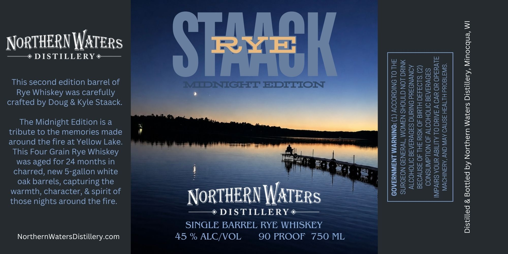

# TTB COLA Label Images - TTBID 26300001000390

**Brand Name:** STAACK RYE MIDNIGHT EDITION

**Issue Date:** 11/03/2026

**Origin Code:** 48

**Product Class/Type:** 102

**Source:** [TTB Public COLA Registry](https://ttbonline.gov/colasonline/viewColaDetails.do?action=publicFormDisplay&ttbid=26300001000390)

## Label Images

### Label 1

## Extracted Label Text

*Text extracted via OCR - may contain errors*

**Detected Proof:** 90

### Label 1

NORTHERN WATERS

——+ DISTILLERY #——

This second edition barrel of
Rye Whiskey was carefully
crafted by Doug & Kyle Staack.

The Midnight Edition is a
tribute to the memories made
around the fire at Yellow Lake.

This Four Grain Rye Whiskey
was aged for 24 months in
charred, new 5-gallon white
oak barrels, capturing the
warmth, character, & spirit of
those nights around the fire.

NorthernWatersDistillery.com

45 % ALC/VOL

NORTHERN

—~¢ DISTILLERY*—_—
SINGLE BARREL RYE WHISKEY

90 PROOF 750 ML

GOVERNMENT WARNING: (1) ACCORDING TO THE

SURGEON GENERAL, WOMEN SHOULD NOT DRINK

ALCOHOLIC BEVERAGES DURING PREGNANCY

BECAUSE OF THE RISK OF BIRTH DEFECTS. (2)

CONSUMPTION OF ALCOHOLIC BEVERAGES
IMPAIRS YOUR ABILITY TO DRIVE A CAR OR OPERATE

MACHINERY, AND MAY CAUSE HEALTH PROBLEMS.

Distilled & Bottled by Northern Waters Distillery, Minocqua, WI
