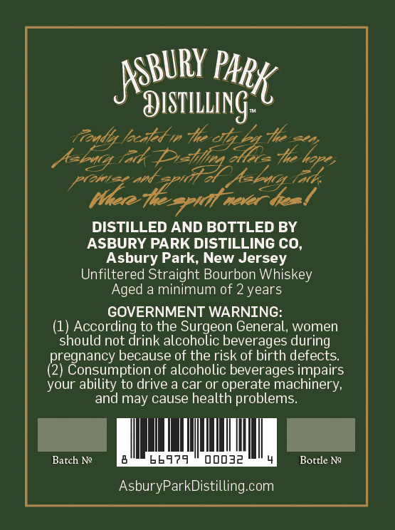
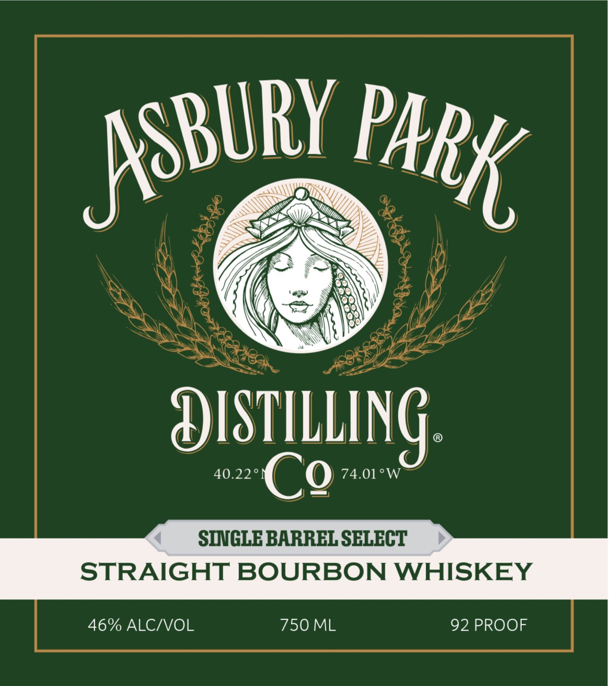

# TTB COLA Label Images - TTBID 26300001000423

**Brand Name:** ASBURY PARK DISTILLING CO.

**Issue Date:** 10/30/2026

**Origin Code:** 02

**Product Class/Type:** 101

**Source:** [TTB Public COLA Registry](https://ttbonline.gov/colasonline/viewColaDetails.do?action=publicFormDisplay&ttbid=26300001000423)

## Label Images

### Back Label

### Front Label

## Extracted Label Text

*Text extracted via OCR - may contain errors*

**Detected Proof:** 92
**Detected Age:** 2 Years

### Back Label

BURY PA,
Narang

Aagly lncitedn he cthjSag The ace
Avbig ith Pratfeg Mee Thchore,
alee on pr fale oe

DISTILLED AND BOTTLED BY
ASBURY PARK DISTILLING CO,
Asbury Park, New Jersey
Unfiltered Straight Bourbon Whiskey
Aged a minimum of 2 years

GOVERNMENT WARNING:

(1) According to the Surgeon General, women
should not drink alcoholic beverages during
pregnancy because of the risk of birth defects.
(2) Consumption of alcoholic beverages impairs
your ability to drive a car or operate machinery,
and may cause health problems.

Batch Ne 6066979 — 00032 L) Bottle Ne

AsburyParkDistilling.com

### Front Label

DISTILLING_
40.22
Co
74.01 'W
SINGLE BARREL SELECT
STRAIGHT BOURBON WHISKEY
46% ALCIVOL
750 ML
92 PROOF
JSBURY
park
