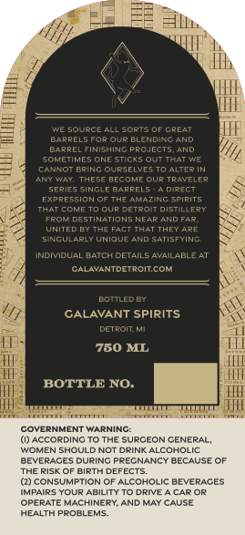
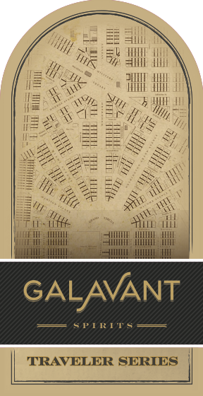
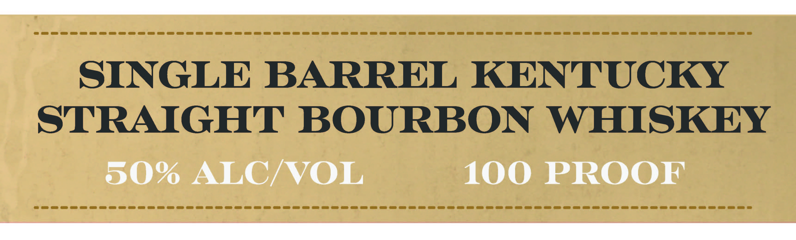

# TTB COLA Label Images - TTBID 26300001000558

**Brand Name:** TRAVELER SERIES

**Fanciful Name:** SINGLE BARREL KENTUCKY STRAIGHT BOURBON WHISKEY

**Issue Date:** 10/30/2026

**Origin Code:** 06

**Product Class/Type:** 101

**Source:** [TTB Public COLA Registry](https://ttbonline.gov/colasonline/viewColaDetails.do?action=publicFormDisplay&ttbid=26300001000558)

## Label Images

### Back Label

### Front Label

### Label 1

## Extracted Label Text

*Text extracted via OCR - may contain errors*

**Detected Proof:** 100

### Back Label

WC SouRcE ALL Sorts Of GREAT
EiPPELSRap Oup @LeNDING GND
BAPRELFINISHINC PRCJECTS
Eamte
Aame
Inam
cannot BrIng QurselveS
ALieR
Fminnl
THESE BECOMEOUR TRAYELER
Series
~INGLF
BARRELS
Dipect
Frnrfenion
Knnaeam
EpifITS
FanCme
Our Detroit distillery
FROM DESTINATIONSNEAF
END Fap
WNTeDE
FactTHaT They ARe
SINCULARLY UNIOU
ANd satisfying
NCIYICUAL
DATCUDETAILS AvLILABLE AT
ALAVANTDETROItcom
LOTLEDET
GALAVANT SPIRITS
DeTRoITKi
750 ML
BOTTLE NO:
COVERNMENT WARNINC:
(0) ACCORDING TO THE SURCEON CENERAL
WOMEN SHOULD NOT DRINK ALCOHOLIC
BEVERACES
DURING
PRECNANCY BECAUSE OF
THE RISK OF BIRTH
FFECTS
(2) CONSUMPTION OF ALCOHOLIC BEVERACES
IMPAIRS YOUR ABILITY TO DRIVE
CAR OR
OPERATE MACHINERY AND MAY CAUSE
HEALTH PPOBLEMS

### Front Label

yy bas ES al
GH sie 0 TN
ie Yor AMIN All
= xy
IBS Ny hi
Hope aeletiot Big
OG gon a SxS
Sy kT Sons.
Shaves Sen
[iets Minn wi
Coie TRIKE AT A
TRAVELER SERIES

### Label 1

eee
SINGLE BARREL KENTUCKY
STRAIGHT BOURBON WHISKEY
50% ALC/VOL 100 PROOF
Ee pape ee
