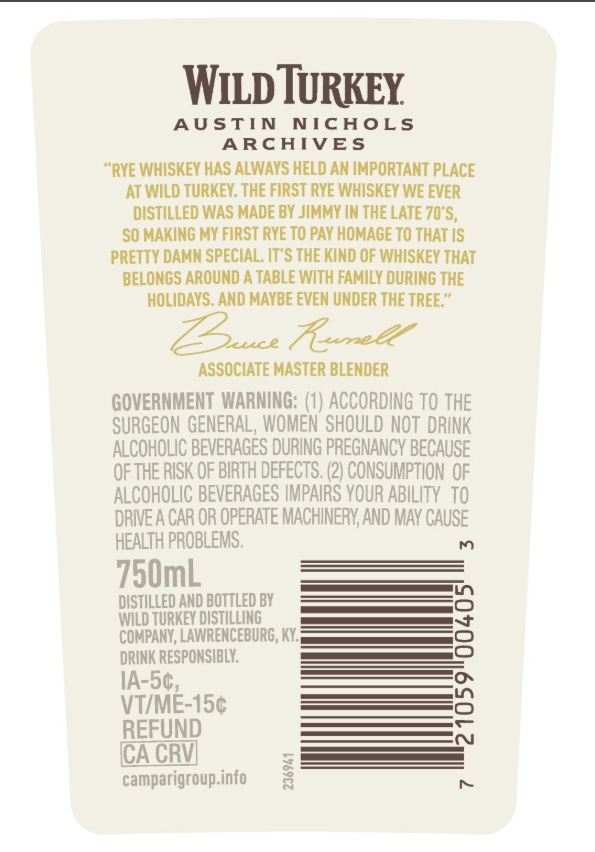
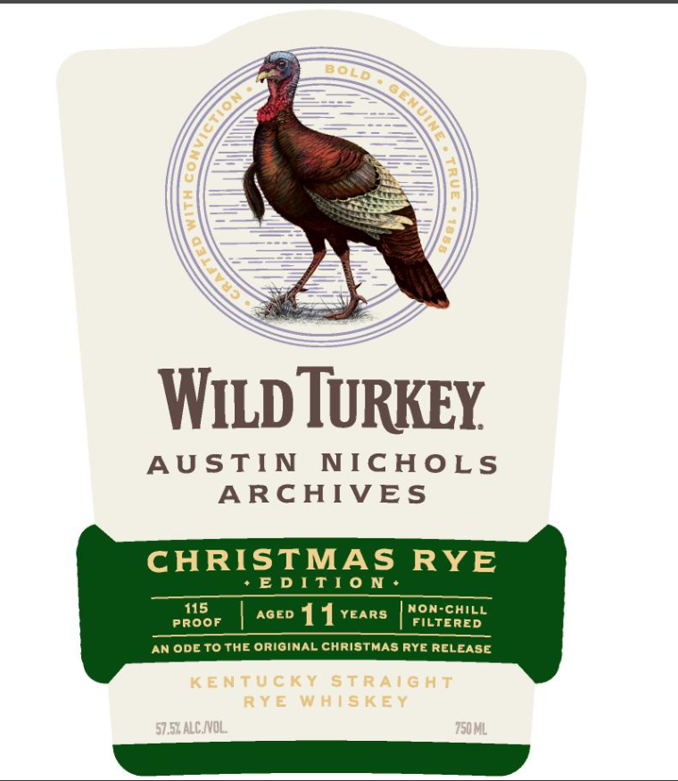
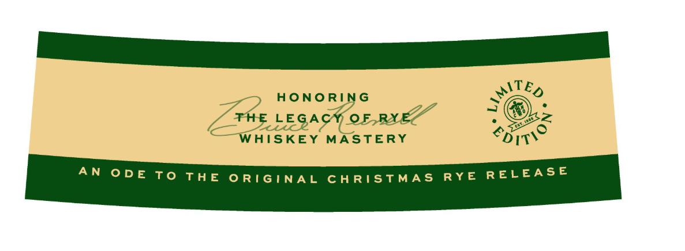

# TTB COLA Label Images - TTBID 26300001000569

**Brand Name:** WILD TURKEY

**Fanciful Name:** AUSTIN NICHOLS ARCHIVES CHRISTMAS RYE EDITION

**Issue Date:** 10/30/2026

**Origin Code:** 22

**Product Class/Type:** 102

**Source:** [TTB Public COLA Registry](https://ttbonline.gov/colasonline/viewColaDetails.do?action=publicFormDisplay&ttbid=26300001000569)

## Label Images

### Back Label

### Front Label

### Label 3

## Extracted Label Text

*Text extracted via OCR - may contain errors*

**Detected Age:** 11 Years

### Back Label

WILD TURKEY

AUSTIN NICHOLS

ARCHIVES

“RYE WHISKEY HAS ALWAYS HELD AN IMPORTANT PLACE

AT WILD TURKEY. THE FIRST RYE WHISKEY WE EVER

SO MAKING MY FIRST RYE TO PAY HOMAGE TO THAT IS

DISTILLED WAS MADE BY JIMMY IN THE LATE 70'S,

PRETTY DAMN SPECIAL. IT’S THE KIND OF WHISKEY THAT

BELONGS AROUND A TABLE WITH FAMILY DURING THE

HOLIDAYS. AND MAYBE EVEN UNDER THE TREE.”

reve ove

ASSOCIATE MASTER BLENDER

GOVERNMENT WARNING: (1) ACCORDING TO THE

SURGEON GENERAL, WOMEN SHOULD NOT DRINK

ALCOHOLIC BEVERAGES DURING PREGNANCY BECAUSE

OF THE RISK OF BIRTH DEFECTS. (2) CONSUMPTION OF

ALCOHOLIC BEVERAGES IMPAIRS YOUR ABILITY TO

DRIVEA CAR OR OPERATE MACHINERY, AND MAY CAUSE

HEALTH PROBLEMS.

750mL

DISTILLED AND BOTTLED BY

————

WILD TURKEY DISTILLING

—

COMPANY, LAWRENCEBURG, KY.

DRINK RESPONSIBLY.

1A-5¢,

VT/ME-15¢

REFUND

(CA CRY

camparigroup.info

### Front Label

WILd TURKEY
AUSTIN
NICHOLS
ARCHIVES
CHRISTMAS
RYE
E D ! T]0 N
115
AGED
11
YEARS
non-Chill
Proof
FILtERED
An OdE ToTHE Original christMas Rye RELEASE
K ENTU€ Ky StR A I G HT
RY E WhIS K E Y
57,54alC NVOL
"750ML
BOLD

### Label 3

HONORING
é THE LEGAG FOr RYEN

ett k (

WHISKEY. MASTERY

AN ODE TO THE ORIGINAL CHRISTMAS RYE RELEASE
