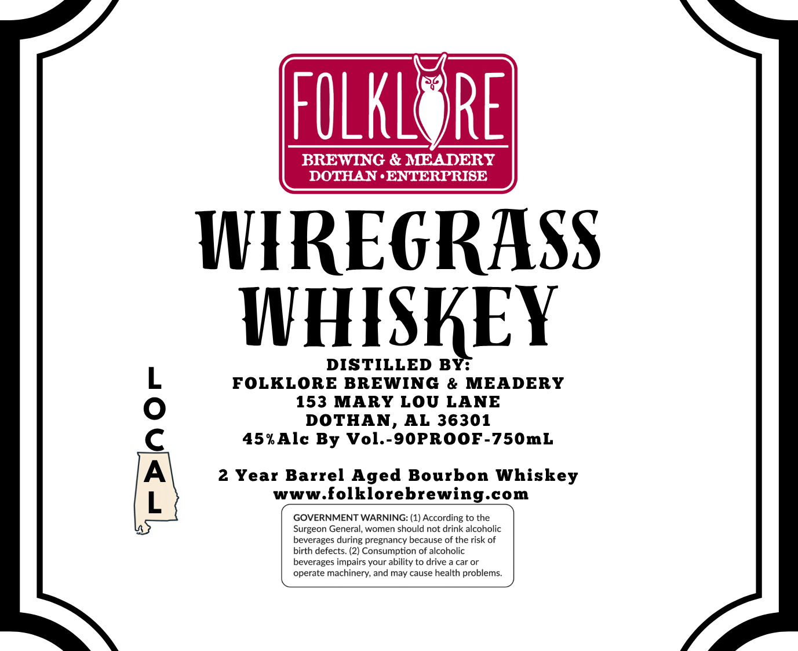
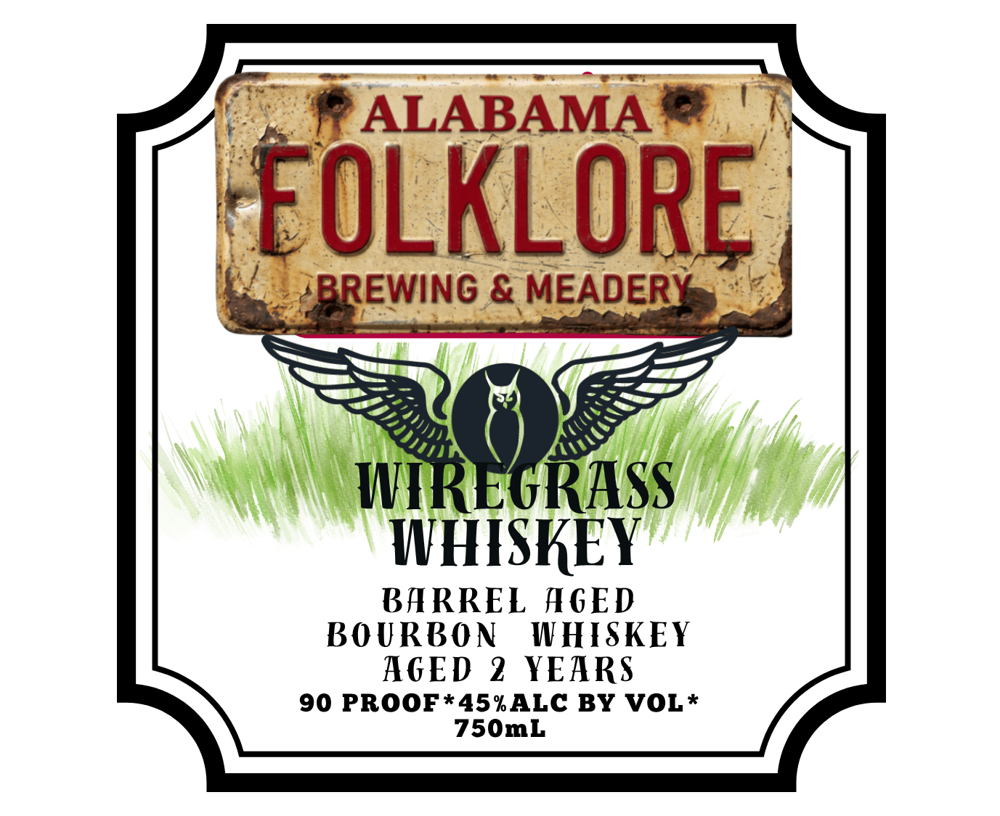

# TTB COLA Label Images - TTBID 26300001000680

**Brand Name:** WIREGRASS WHISKEY

**Issue Date:** 11/13/2026

**Origin Code:** 10

**Product Class/Type:** 141

**Source:** [TTB Public COLA Registry](https://ttbonline.gov/colasonline/viewColaDetails.do?action=publicFormDisplay&ttbid=26300001000680)

## Label Images

### Back Label

### Front Label

## Extracted Label Text

*Text extracted via OCR - may contain errors*

**Detected Proof:** 90
**Detected Age:** 2 Years

### Back Label

FOLKLC
RE
BREWING & MEADERY
DOTHAN .ENTERPRISE
IIREGRHSS
IHISKEY
DISTILLED BY:
FOLKLORE BREWING &
MEADERY
153 MARY LOU LANE
DOTHAN, AL 36301
1
45%Alc By Vol.-9OPROOF-750mL
2 Year Barrel Aged Bourbon
Whiskey
www_folklorebrewing-com
GOVERNMENT WARNING: (1) According to the
Surgeon General, women should not drink alcoholic
beverages
pregnancy because of the risk of
birth defects: (2) Consumption of alcoholic
beverages impairs your ability to drive
car Or
operate machinery, and may cause health problems
during

### Front Label

ALABAMA
EOLKLORE
BREWING & MEADERY
IIREGRASS
WHISKEY
BHRREL AGED
BOURBON
W HISKEY
AGED
2
YEARS
90 PROOF*45%ALC BY
VOL *
75OmL
