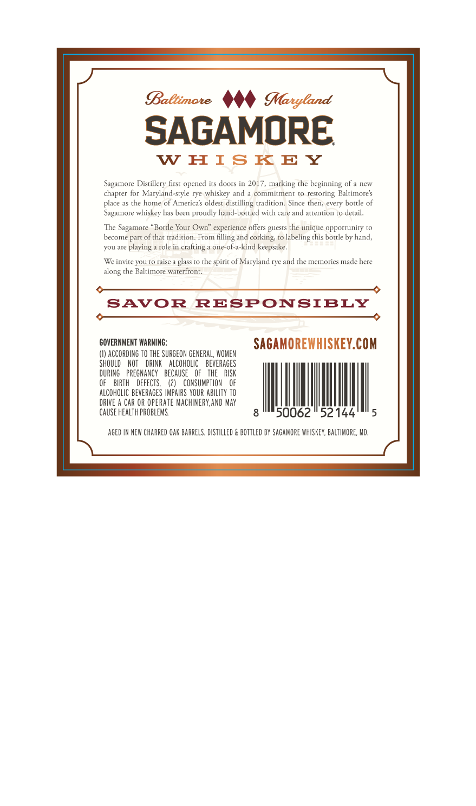
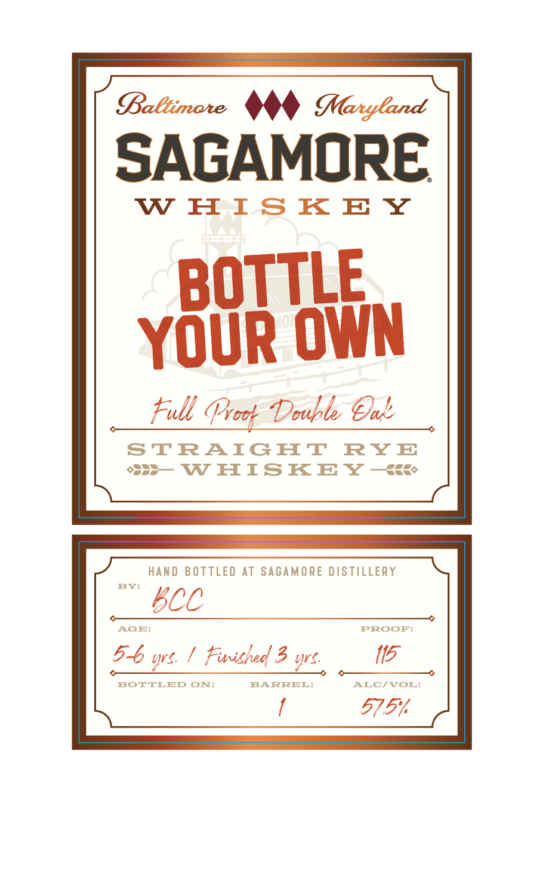

# TTB COLA Label Images - TTBID 26300001000688

**Brand Name:** SAGAMORE

**Fanciful Name:** FULL PROOF DOUBLE OAK

**Issue Date:** 11/04/2026

**Origin Code:** 25

**Product Class/Type:** 102

**Source:** [TTB Public COLA Registry](https://ttbonline.gov/colasonline/viewColaDetails.do?action=publicFormDisplay&ttbid=26300001000688)

## Label Images

### Back Label

### Label 1

## Extracted Label Text

*Text extracted via OCR - may contain errors*

### Back Label

Baetimate
MManyland
SAGAMORE
W
H ISK EY
Sagamore Disrillery firsr opened irs doors in 2017,
rhe
beginning of
new
chaprer for Maryland-sryle rye whiskey and
commitment
resroring Baltimore $
place as the home of Americas oldest
distilling tradition. Since rhen; every borrle of
Sagamore whiskey has been proudly hand-borrled wirh care and arrention ro derail
The
Sagamore "Borrle Your Own" experience offers
che unique opporrunity
become part of rhar tradition_
From
and
chis borrle by hand,
On
are playing
role in
one-of-a-kind keepsake.
We invire VOUI TO raise
elass to the spirir of Maryland rye and the memories made here
che Balrimore warerfront;
SAvoR
RESPONSIBLY
GOVERNMENT WARNINc:
SAGAMOREWHISKEY.COM
ACCORDING TO THE SURGEON GENERAL, WOMEN
ShOuld   NOT
DRINK   AlCohOLIC
BEVERAGES
DURING   PREGNANCY   BECAUSE
OF   THE   RISK
BIRTH
DEFECTS
CONSUMPTLON
ALCOHOLIC BEVERAGES IMPAURS YOUR ABILITY TO
DRIVE
CAR OR OPERATE MACHINERX,AND MAY
CAUSE HEALTH PROBLEMS
50062
52144
AGEd IN NeW ChARRED Oak BARReLS. distilled
BOTTLEd BY SAGAMORE WhISKEY, BALTIMORE, MD,
mnatking
Guests
Gilling
corking;
labeling
crafting
along'

### Label 1

SAGAMORE

WHISKEY

OTTLE
YOUR OWN

Full Proot Double Cad:

STRAIGHT RYE
oss WHISKEY —kk&

HAND BOTTLED AT SAGAMORE DISTILLERY
