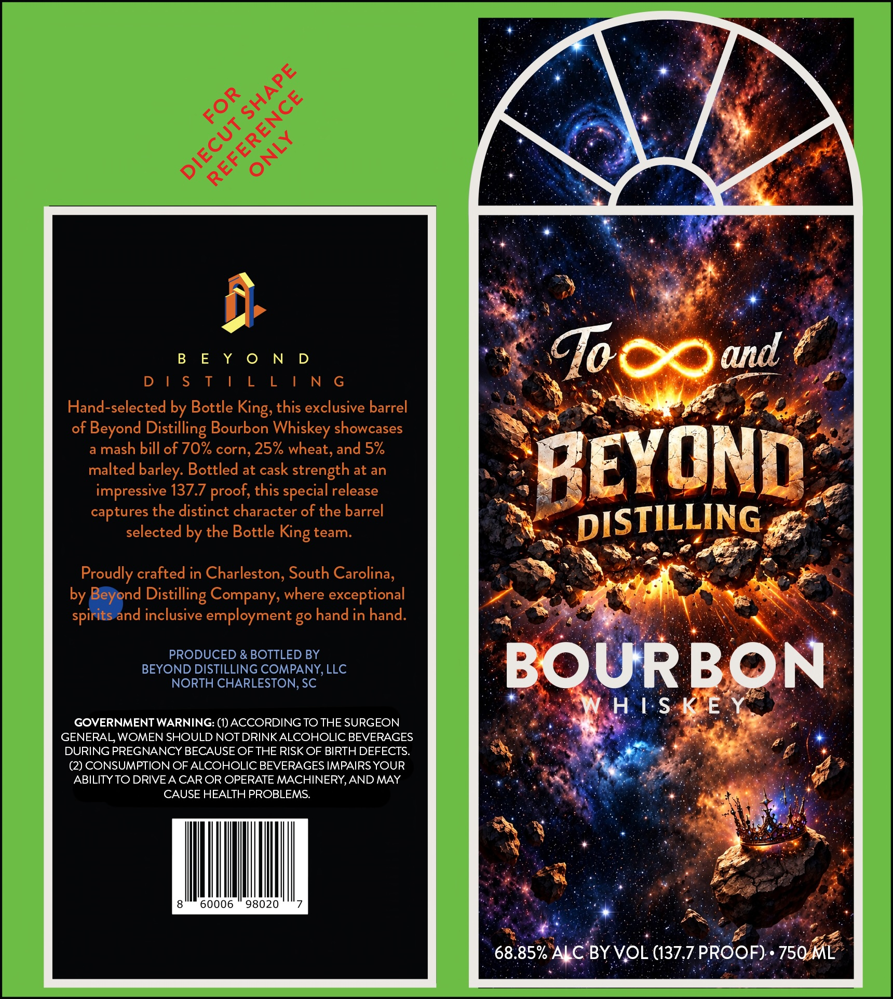

# TTB COLA Label Images - TTBID 26301001000061

**Brand Name:** BEYOND DISTILLING BOURBON

**Issue Date:** 11/24/2026

**Origin Code:** 41

**Product Class/Type:** 141

**Source:** [TTB Public COLA Registry](https://ttbonline.gov/colasonline/viewColaDetails.do?action=publicFormDisplay&ttbid=26301001000061)

## Label Images

### Label 1

## Extracted Label Text

*Text extracted via OCR - may contain errors*

**Detected Proof:** 137.7

### Label 1

B E Y 0 N D
To
and
D | $ T | L L | N G
Hand-selected by Bottle
this exclusive barrel
of Beyond Distilling Bourbon Whiskey showcases
a
mash bill of 70% corn; 25% wheat, and 5%
malted barley: Bottled at cask strength at an
REYOND
impressive 137.7 proof; this
release
captures the distinct character of the barrel
selected by the Bottle
team:
DISTILLING
Proudly crafted in Charleston, South Carolina,
by Beyond Distilling Company, where exceptional
and inclusive employment go hand in hand:
PRODUCED & BOTTLED BY
BEYOND DISTILLING COMPANY,LLC
BOURBON
NORTH CHARLESTON, SC
WH|S KE Y
GOVERNMENT WARNING: (1)ACCORDING TO THE SURGEON
GENERAL WOMEN SHOULD NOTDRINKALCOHOLIC BEVERAGES
DURING PREGNANCY BECAUSE OF THE RISK OF BIRTH DEFECTS_
(2) CONSUMPTION OF ALCOHOLIC BEVERAGES IMPAIRS YOUR
ABILITY TO DRIVEA CAR OR OPERATE MACHINERY,AND MAY
CAUSE HEALTH PROBLEMS:
60006
98020
68.85% ALC BY VOL (137.7 PROOF) . 750ML
SHAPE
FOR
REFERENCE
DIECUT
ONLY
King;
special
King "
spirits
