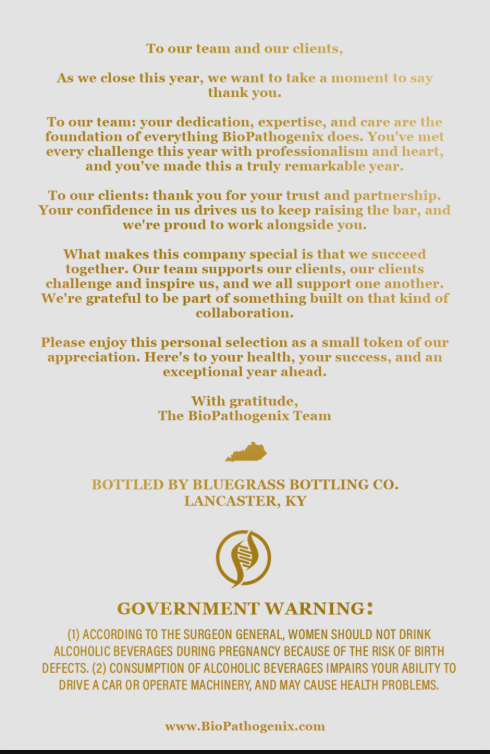
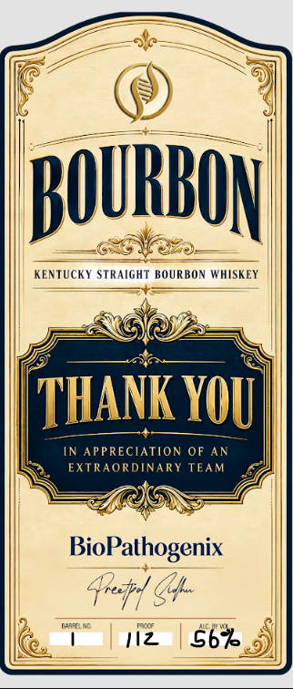

# TTB COLA Label Images - TTBID 26301001000142

**Brand Name:** BIOPATHOGENIX

**Issue Date:** 11/19/2026

**Origin Code:** 22

**Product Class/Type:** 101

**Source:** [TTB Public COLA Registry](https://ttbonline.gov/colasonline/viewColaDetails.do?action=publicFormDisplay&ttbid=26301001000142)

## Label Images

### Back Label

### Front Label

## Extracted Label Text

*Text extracted via OCR - may contain errors*

### Back Label

To our" team and Ou" clients,
41S WC
this Year;
Wah to take
MOMCH |o say
thalk youa
To our tean: YOur dedication; expertise
care
aTn
foundation of everything BioPathogenix does: You ve met
every challenge this year with professionalism and heart;
and you've made this
truly renarkable yean.
To Our" clients: thank you for vour trust and partnerslipa
Your confidencc
US drives uS t0 kecp raising the bar , and
were
pFOud t0 work alongside youa
What makes this company special is that we sueceed
together. Our team supports Our" clients; Our" clients
challenge and inspire uS_
and we all support one another.
Were
grateful to be part of something
0n tlat kind of
coMaboratiom:
Please enjoy this personal selection as
small token of our
appreciation. Here'
to your healtl; YOur" success; and aT
exceptional year ahead.
Witl gratitude,
The BioPalhogenix Team
KOTTLED BY BLUEGRASS BOTTLING CO.
LANCASTER, KY
GOVERNMENT WARNING :
(0) ACCORDING TO THE SURGEON GENERAL; WOMEN SHOULD NOT DRINK
ALCOHOLIC BEVERAGES DURING PAEGNANCY BECAUSE OF THE RISK OF BIRTH
DEFECTS: (2) CONSUMPTION OF ALCOHOLIC BEVERAGES LMPAIRS YOUR AbIlITY To
DRIVE
CAR OR OPERATE MACHINERV; AND MAY CAUSE HEALTH PROBLEMS;
Ltnl
BioPathogenix Com
close
aual
the
built

### Front Label

BOURBON
KENTUCKY STRAIGHT BOURRON WHISKEY
THANK YOU |
IN APPRECIATION OF
AN
EXTRAORDINARY TEAM
BioPathogenix
4rt1 G
643ee
Iz
567
