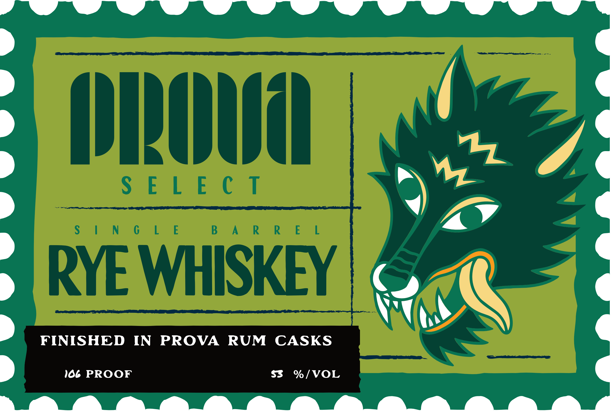
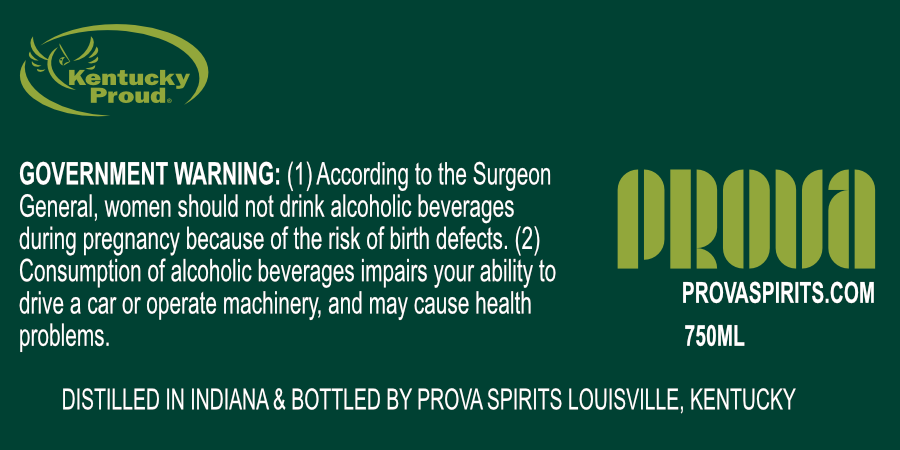

# TTB COLA Label Images - TTBID 26301001000205

**Brand Name:** PROVA

**Issue Date:** 11/02/2026

**Origin Code:** 22

**Product Class/Type:** 142

**Source:** [TTB Public COLA Registry](https://ttbonline.gov/colasonline/viewColaDetails.do?action=publicFormDisplay&ttbid=26301001000205)

## Label Images

### Label 1

### Label 2

## Extracted Label Text

*Text extracted via OCR - may contain errors*

*1 image(s) excluded: text did not meet readability threshold*

### Label 2

entucky

GOVERNMENT WARNING: (1) According to the Surgeon

General, women should not drink alcoholic beverages

during pregnancy because of the risk of birth defects. (2)

DROW

Consumption of alcoholic beverages impairs your ability to

PROVASPIRITS.COM

drive a car or operate machinery, and may cause health

problems.

750ML

DISTILLED IN INDIANA & BOTTLED BY PROVA SPIRITS LOUISVILLE, KENTUCKY
