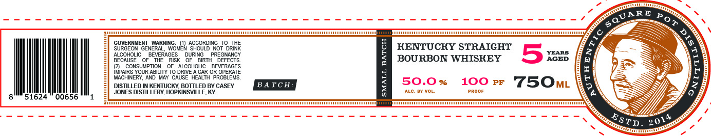

# TTB COLA Label Images - TTBID 26301001000227

**Brand Name:** COACH G FOUNDATION

**Issue Date:** 11/02/2026

**Origin Code:** 22

**Product Class/Type:** 101

**Source:** [TTB Public COLA Registry](https://ttbonline.gov/colasonline/viewColaDetails.do?action=publicFormDisplay&ttbid=26301001000227)

## Label Images

### Front Label

### Label 2

## Extracted Label Text

*Text extracted via OCR - may contain errors*

*1 image(s) excluded: text did not meet readability threshold*

**Detected Proof:** 100

### Label 2

WIAIIIAAITAAATUITTNTI
WiautiaaittitauiANATTATIIII
GOVERNMENT   WARNING:
(1 ACCORDING TO THE
KENTUCKY STRAIGHT
SURGEON GENERAL
WOMEN SHOULD NOT DRINK
BECAUOLI
OFBEVERAGESK
RISK
DURING
BGRT-PREGHECTS
]
BOURBON WHISKEY
5
XEEB
CONSUMPTICN
ALCOHOLIC
BEVERAGES
{ZPAGOI
OUR ABILITY TO DRIVE
CAR OR OPERATE
MACHINERY, AND May CAUSE HEALTH PRCBLEMS.
DISTILLED IN KENTUCKY BOTTLED BY CASEY
BA TC H:
7
50.0 %
100
PF
750ML
JONES DISTILLERY, HOPKINSVILLE, KY
ALC.
DY Vol
pRoOr
51624
00656
aanaanaaaamniamanaanmaaaamamiamanamaai
)
QUARE
Pot
6
:
{
ESTD
201
