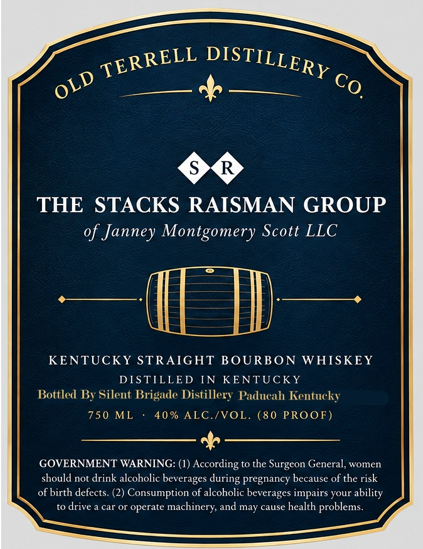
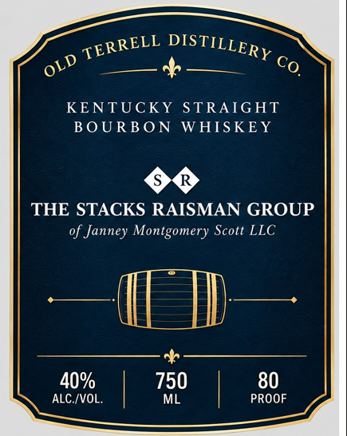

# TTB COLA Label Images - TTBID 26301001000252

**Brand Name:** OLD TERREL

**Issue Date:** 11/02/2026

**Origin Code:** 22

**Product Class/Type:** 101

**Source:** [TTB Public COLA Registry](https://ttbonline.gov/colasonline/viewColaDetails.do?action=publicFormDisplay&ttbid=26301001000252)

## Label Images

### Back Label

### Front Label

## Extracted Label Text

*Text extracted via OCR - may contain errors*

**Detected Proof:** 80

### Back Label

Co
THE STACKS RAISMAN GROUP
Janney Montgomery Scott LLC
KENTUCKY STRAIGHT BOURBON WHISKEY
DISTILLED N KENTUCKY
Bottlevl B, Silent Brigade Distillery Paduah Kentucky
750 ML
4090 ALC /VOL. (80 PROOF)
GOVERNMENT WARNING: (1) According to the Surgeon General, women
should not drink alcoholic bevcrages during pregnancy because
risk
olnnntnnedctcs
(2) Consumption
alcoholic beverages impairs your ability
drive
opcrai
machinery;
and mav cause hcalth
problems.
TERRELL
DISTILLERY
OLD

### Front Label

KENTUCKY
STRAIGHT
BOURB ON
WHIS KEY
THE STACKS RAISMAN GROUP
Janney Montgomery Scott LLC
40%
750
80
ALC /VOL
ML
PROOF
DISTILLERY
TERRELL
OLD
co.
