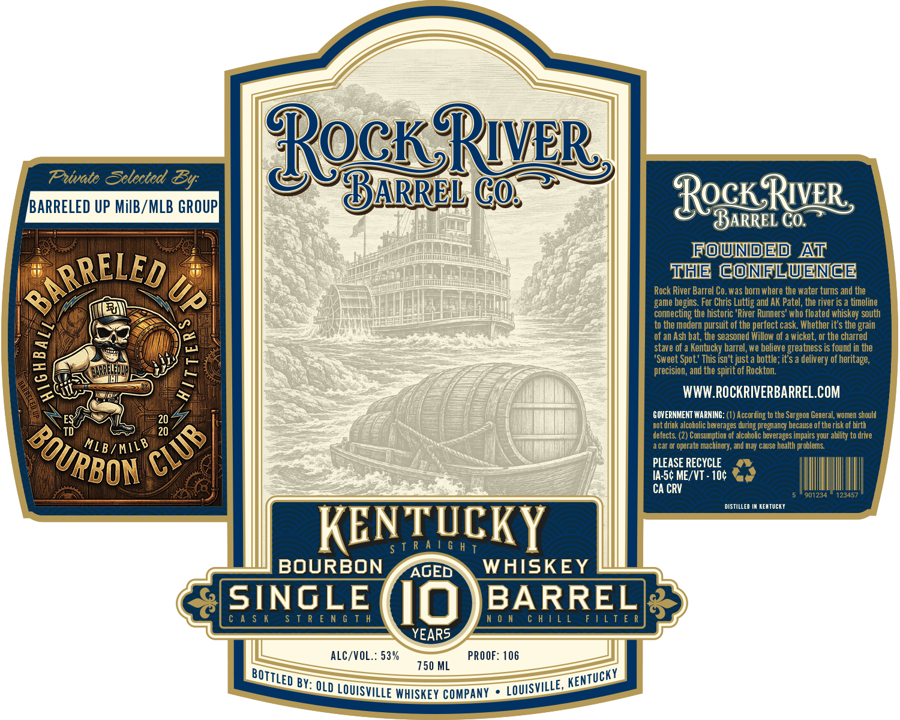

# TTB COLA Label Images - TTBID 26301001000415

**Brand Name:** ROCK RIVER BARREL CO.

**Issue Date:** 11/03/2026

**Origin Code:** 22

**Product Class/Type:** 101

**Source:** [TTB Public COLA Registry](https://ttbonline.gov/colasonline/viewColaDetails.do?action=publicFormDisplay&ttbid=26301001000415)

## Label Images

### Front Label

## Extracted Label Text

*Text extracted via OCR - may contain errors*

**Detected Proof:** 106

### Front Label

ip)

V

Private Selected Ey:

DOGISK

CO, >

) |

QARREL

OCK

IV.

meek

ROW NIDIE DBA

THE CONFLUENCE

RELED

Rock River Barrel Co. was born where the water turns and the

Lulz

game begins. For Chris Luttig and AK Patel, the river is a timeline

2

(

ee

onnecti

the historic 'River Runners' who floated whiskey south

|

se

of an Ash bat, the seasoned Willow of a wicket, or the charred

to the modern pursuit of the perfect cask. Whether it’s the grain

=

Stave of a Kentucky barrel, we bel

eatness is found in the

ma)

1

‘Sweet Spot.’ This isn't just a bottle; it’s a delivery of heritage,

MT

ony

precision, and the spirit of Rockton.

ot

ie

NSA KK

WWW.ROCKRIVERBARREL.COM

‘ot drink alcoholic

GOVERNMENT WARNINE

uring

Jing tothe Surgeon Ge

ey

2 of the

3, women should

of birth

1)

“20

defects.

onsumption of alcoholic bey

impa

our ability to drive

TORS

aca or operate machinery, and may cause heath problem

D,

NY

PLEASE RECYCLE ”

RBON ©

CA CRY

UN-5¢ ME/VT- 106 Ya?

Ill

DISTILLED IW KENTUCKY

NTUC

KE

gTRAIGHT

KY

BOURBON

AGED

WHISKEY

SINGLE

BARRE

cA

TREN

TH

10

NO

at

ay ES

YEARS.

ALC/VOL.: 53%

PROOF: 106

BOTTLED By OLD LOUISVILLE WHISKEY COMPANY * LOUISVILLE KENTUCKY
