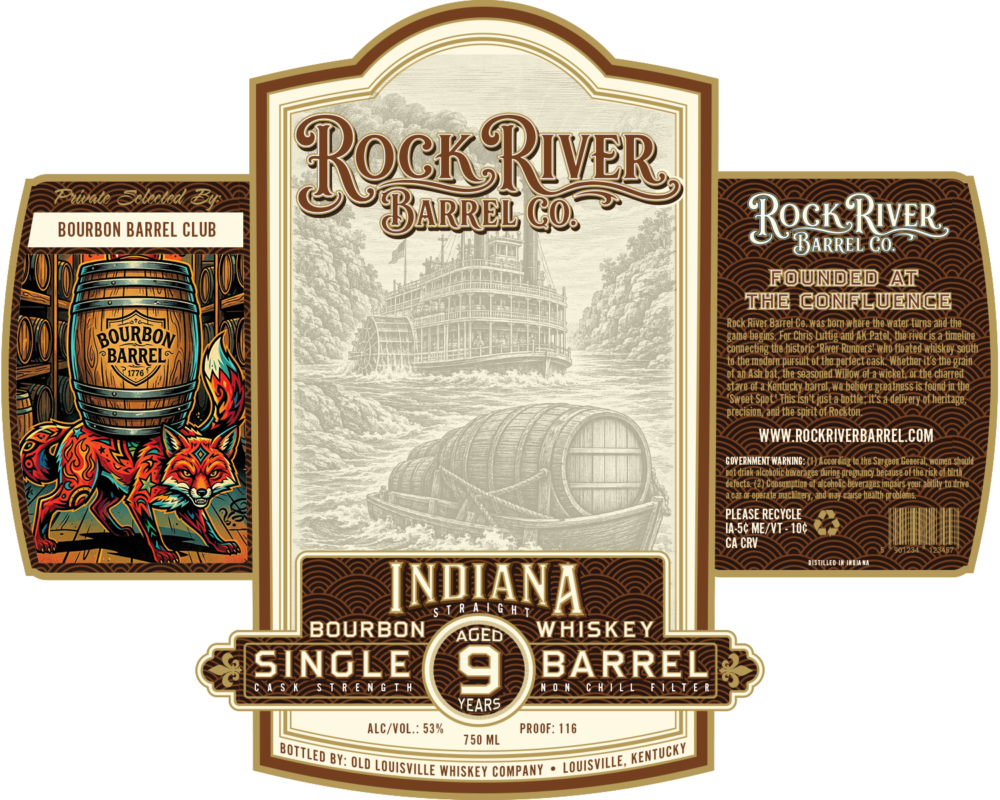

# TTB COLA Label Images - TTBID 26301001000416

**Brand Name:** ROCK RIVER BARREL CO.

**Issue Date:** 11/03/2026

**Origin Code:** 22

**Product Class/Type:** 101

**Source:** [TTB Public COLA Registry](https://ttbonline.gov/colasonline/viewColaDetails.do?action=publicFormDisplay&ttbid=26301001000416)

## Label Images

### Front Label

## Extracted Label Text

*Text extracted via OCR - may contain errors*

**Detected Proof:** 106

### Front Label

BOURBON Barrel CLUB
RockRyr
COs
RocK_RuvER
BARREL Co:
rouned
At
The ConiluenCe
Rock River Barrel Co.Was born Where the water turns
the
BOURBON
game begins. For Chris Luttig and AK Patel, the river iS a timeline
~connecting the historic 'River Runners' who floated whiskey south
BARRELS
to the modern pursuit of the perfect cask' Whether it'$ the grain
1776
of an Ash bat , the seasoned
of a wicket, or the charred
stave of a Kentucky barrel, we believe greatness is found in the
"Sweet Spot ' This iSn't just a bottle, it $ a delivery of heritage,
precision, and the spirit of Rockton
WWW ROCKRIVERBARREL.COM
GOVERNMENT WARNING:
According to the Surgeon General; Womten should
Iot drink alcoholic beverages during pregnancy because of the risk of birth
defects: (2) Consumption of alcoholic beverages impairs your ability to drive
acar Or operate
 Machinery, and may
cause health problems
PLEASE RECYCLE
IA-5c ME/VT - 10c
CA CRV
901234
dstiLLED
IHDMA Na
INQIANA
$ T R A | 6 H T
BOURBON
AGED
WHISKEY
SINGLE
9
BARREL
A $ K
$ T R E N G T h
n 0 n
c H | [ [
FI[T E R
YEARS
Alc/VOL.: 53%
PROOF: 116
750 ML
By: OLD LOUISVILLE WHISKEY COMPANY
and
Willow
BOTTLED
KeNTUCKY
LOUISVILLE,
