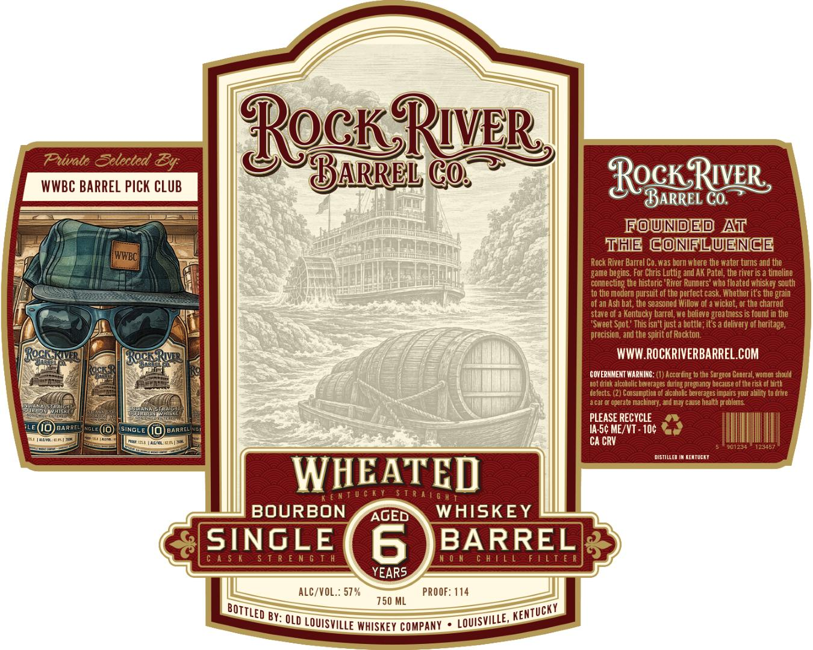

# TTB COLA Label Images - TTBID 26301001000417

**Brand Name:** ROCK RIVER BARREL CO.

**Issue Date:** 11/10/2026

**Origin Code:** 22

**Product Class/Type:** 101

**Source:** [TTB Public COLA Registry](https://ttbonline.gov/colasonline/viewColaDetails.do?action=publicFormDisplay&ttbid=26301001000417)

## Label Images

### Front Label

## Extracted Label Text

*Text extracted via OCR - may contain errors*

**Detected Proof:** 114

### Front Label

Puwvalo Selected
RocnRyee
WWBC BARREL Pick CLUB
Cos
Rock_RuER
BARREL Co
FoundEd At
THE CoNFLUENCE
Kwwec|
Rock River Barrel Co.was born where the water tums and the
game begins. For Chris Luttig and AK Patel, the river is a timeline
connecting the historic 'River Runners' who floated whiskey south
to the modern pursuit of the pertect cask. Whether its the grain
~of an Ash bat, the seasoned Willow of
wicket , or the charred
stave Of
Kentucky barrel we believe greatness is found in the
'Sweet Spot ' This isn't just a bottle; it $ a delivery of heritage,
precision , and the spirit of Rockton
[Bocaar
[Rork Ruv
WWW ROCKRIVERBARREL.COM
Rock
COYERHHENT WARNINC: (1) According to the Surgaoa General, women should
Fot drink alcoholic beverazes turing pregnancy because ol the risk of birth
Lefects (2) Consumption ol alccholc beverages impairs Your ability to drite
car
operate macbiner], end May Czuse health probles
Hae
PLEASE RECYCLE
BARREL)
Ncie
SINGLE
BARREL
Ia Sc MEZVT - 10c
HGun.
Ca CRV
J01zjt
[23457
DISTILLED IN KehTUEKT
WHEATED
5 T 0
BOURBON
AGED
WHISKEY
SINGLE
6
BARREL
4 $ K
5 T R E n G T h
0 n [ h| ! L
1[T [
YEARS
ALC/VOL : 57 %
PROOF: 114
750 ML
By: QLD LOUISVIlle WHISKEY COMPANy
By:
V [
BOTTLED
KentUcKY
LOUISVILLE;
