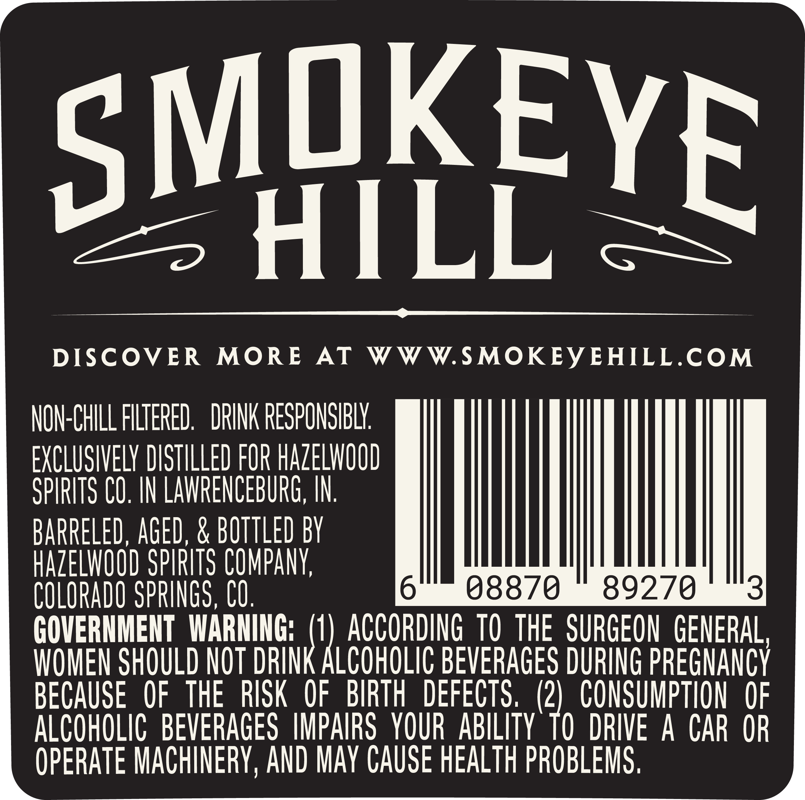
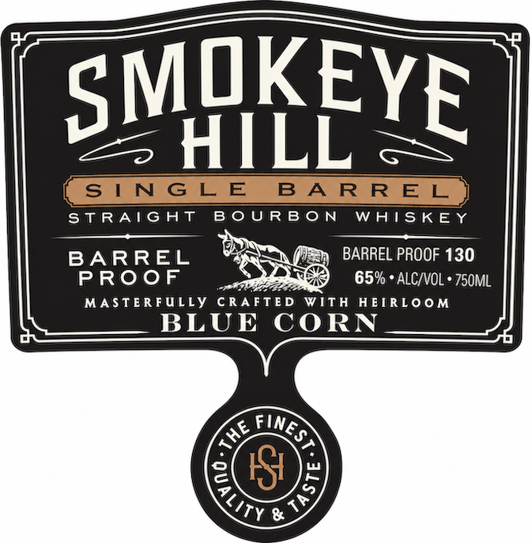
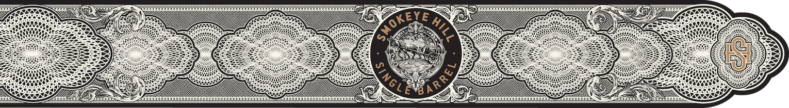

# TTB COLA Label Images - TTBID 26301001000418

**Brand Name:** SMOKEYE HILL

**Issue Date:** 11/06/2026

**Origin Code:** 13

**Product Class/Type:** 101

**Source:** [TTB Public COLA Registry](https://ttbonline.gov/colasonline/viewColaDetails.do?action=publicFormDisplay&ttbid=26301001000418)

## Label Images

### Back Label

### Label 1

### Label 3

## Extracted Label Text

*Text extracted via OCR - may contain errors*

*1 image(s) excluded: text did not meet readability threshold*

**Detected Proof:** 130

### Back Label

SMIKEYE
HILL
DISCOVER
MORE
AT
WWW.SMOKEY EHILL.COM
NON-CHILL FILTERED:
DRINK RESPONSIBLY
EXCLUSIVELY DISTILLED FOR HAZELWOOD
SPIRITS CO. IN LAVRENCEBURG, IN
BARRELED, AGED, & BOTTLED BY
HAzELWOOD SPIRITS COMPANy;
COLORADO SPRINGS, CO.
6
08870
89270
3
GOVERNMENT  WARNING;
ACCORDING TO the  SURGEON GENERAL,
WOMEN SHOULD NOT DRINK ALCOHOLIC BEVERAGES DURING PREGNANCY
BECAUSE
OF   THE  RISK
OF
BIRTH
DEFECTS ,
(2)
CONSUMPTION
OF
ALCOHOLIC   BEVERAGES IMPAIRS   YOUR ABILITY' TO  DRIVE
A
CAR OR
OPERATE MACHINERY, AND MAY CAUSe HEALTH PROBLEMS;

### Label 1

STRAIGHT BOURBON WHISKEY
BARREL ~ » BARREL PROOF 130
PROOF Hitt 65% * ALC/VOL * 750ML
MASTERFULLY CRAFTED WITH HEIRLOOM
U BLUE CORN
< FIN,
1@:
oOo uw
WOLs
eZ
S
rye
