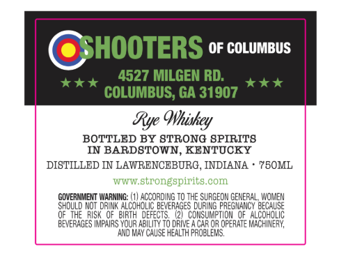
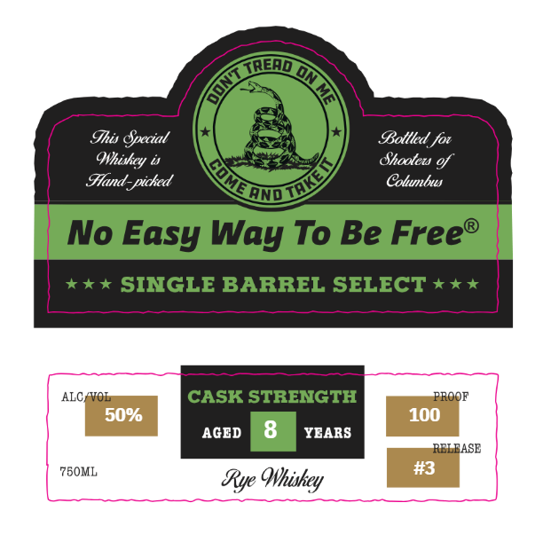

# TTB COLA Label Images - TTBID 26301001000425

**Brand Name:** SHOOTERS OF COLUMBUS

**Fanciful Name:** CASK STRENGTH

**Issue Date:** 11/05/2026

**Origin Code:** 22

**Product Class/Type:** 142

**Source:** [TTB Public COLA Registry](https://ttbonline.gov/colasonline/viewColaDetails.do?action=publicFormDisplay&ttbid=26301001000425)

## Label Images

### Back Label

### Front Label

### Label 3

## Extracted Label Text

*Text extracted via OCR - may contain errors*

*1 image(s) excluded: text did not meet readability threshold*

**Detected Proof:** 100
**Detected Age:** 8 Years

### Back Label

SHOOTERS
OF COLUMBUS
4527 MILGEN RD:
COLUMBUS; GA 31907
Rye Ohiskey
BOTTLED BY 8TRONG SPIRITS
IN
BARDSTOWN, KENTUCKY
DISTILLED IN LAWRENCEBURG, INDIANA
7B0ML
TATTTW strongspirits com
GOVERNMENT WARNING:
WE UHaEEDEDUE:
To THE
eSURGEOH:
GENERAL WOMEN
should Not drINK
BEVERAGES
FREGMANCY eeCAUSE
OFIHE   RISK QF   BIRTH  DEFECTS
(21  CONSUMPTION @F
Hcahone
BEVERAGES IMPAIRS YOUR ABILITY T0 DFIVE
CAR 03 OFERATE L
AND K4Y CAUSE HEALTH proELEMS,

### Front Label

TnenD
On
Ihis Special
Bollled for
Shooters gf
Hand-piched
Cotuumnbws
andIl
No Easy Way To Be Free
X *
SINGLE BARREL SELECT * * *
ALC /VOL
CASK STRENGTH
ROOF
50%
100
AGED
8
YEARS
RBLEASE
75OML
#3
Rye Qhiskey
Ohiskcy
