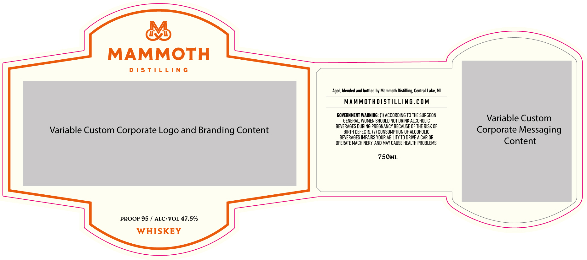

# TTB COLA Label Images - TTBID 26301001000439

**Brand Name:** MAMMOTH DISTILLING

**Issue Date:** 11/04/2026

**Origin Code:** 06

**Product Class/Type:** 140

**Source:** [TTB Public COLA Registry](https://ttbonline.gov/colasonline/viewColaDetails.do?action=publicFormDisplay&ttbid=26301001000439)

## Label Images

### Label 1

## Extracted Label Text

*Text extracted via OCR - may contain errors*

**Detected Proof:** 95

### Label 1

&

MAMMOTH

DISTILLING

Variable Custom Corporate Logo and Branding Content

PROOF 95 / ALC/VOL 47.5%
WHISKEY

‘Aged, blended and bottled by Mammoth Distilling, Central Lake, MI

MAMMOTHDISTILLING.COM

GOVERNMENT WARNING: (1) ACCORDING TO THE SURGEON
GENERAL, WOMEN SHOULD NOT DRINK ALCOHOLIC
BEVERAGES DURING PREGNANCY BECAUSE OF THE RISK OF
BIRTH DEFECTS. (2) CONSUMPTION OF ALCOHOLIC
BEVERAGES IMPAIRS YOUR ABILITY TO DRIVE A CAR OR
OPERATE MACHINERY, AND MAY CAUSE HEALTH PROBLEMS.

750ML

Variable Custom
Corporate Messaging
Content
